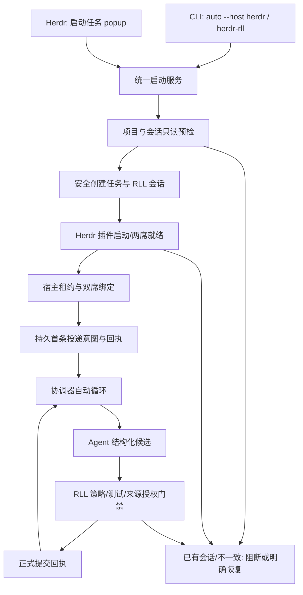

# Ralph-Lisa × Herdr：一条命令启动与自动协作实施方案

> 状态：实施设计，尚未完成本文所述的自动提交与统一启动入口。
>
> 日期：2026-11-06。
>
> 开发仓：`/Users/fugur/work/ai-program/Ralph-Lisa-Loop-herdr`，公开 fork `yueweilu/Ralph-Lisa-Loop`。
>
> 基线：`fork/feat/herdr-s4-server-epoch-fence` 的 `4812b8b16f7f967394f129b0635c423f5a7345dc`。
>
> 实施分支：`feat/herdr-auto-task-launch`。
>
> 范围：先聚焦 Ralph/Claude 与 Lisa/Codex；保留现有 tmux 模式。

## 1. 决策摘要

用户应能够在项目目录直接运行：

```bash
ralph-lisa auto --host herdr "为这个项目新增登录功能，并运行测试"
```

也提供等价短命令：

```bash
herdr-rll "为这个项目新增登录功能，并运行测试"
```

Herdr 内提供“启动 Ralph-Lisa 任务”的短暂终端弹窗，输入同样的项目任务。三个入口只负责收集输入并调用**同一个启动服务**；RLL 仍决定任务、轮次、提交、评审和门禁，Herdr 负责工作区、终端窗格、Agent 启动、活动观察和提示投递。不要把 `ralph-lisa auto` 启在 Herdr Pane 内来复用 tmux；那会再创建内层 tmux，Herdr 无法把 Ralph/Lisa 当作两个独立 Agent 管理。

本方案的完成定义是：从任一入口启动后，Ralph 产生可审计的正式提交，Lisa 独立评审并正式提交，协调器按回执把下一轮只投递一次；正常合格轮次无需逐份人工来源确认。**当前版本并未达到此定义**：真实双向交接曾在逐份人工确认后通过，不能当作全自动提交已经完成。

### 1.1 三个容易混淆的“自动”

| 名称 | 准确含义 | 本方案处理 |
|---|---|---|
| 自动启动 | 创建任务，启动两席并发送首条任务提示 | 三个入口都要具备 |
| 自动轮次 | 根据 RLL 正式回执向对侧投递下一轮 | 复用现有 Herdr 协调器并补齐启动/恢复 |
| 自动提交 | 合格 Agent 候选经过门禁后无需逐份人工确认而形成正式回执 | **需新增明确协议**；不能用现有 `confirm-candidate` 假造人工确认 |

`--full-auto` 是 Claude/Codex 的执行权限配置，与上述“自动轮次”不同。默认 `auto --host herdr` 应自动交接，但不暗中替用户接受目录信任、登录、系统授权或发布/部署权限。`--full-auto` 的具体 Agent 参数、支持版本和风险提示需在隔离实测后固定；即使启用，也不扩大 RLL 的项目策略、测试和发布门禁。

## 2. 已验证现状与未完成部分

| 位置 | 当前事实 | 对实施的影响 |
|---|---|---|
| `cli/src/cli.ts`、`cli/src/commands.ts` | `auto` 直接进入 `cmdAuto`；`cmdAuto` 混合 tmux、任务初始化、watcher、输出监控和手工接管 | 在 CLI 解析处先分流宿主，Herdr 分支不可进入 tmux 代码；旧分支原样回归 |
| `cli/src/commands.ts:156` | `cmdInit` 删除并重建已有 `.dual-agent` | 新入口必须提供拒绝覆盖的安全初始化，不能直接拿 `cmdInit` 处理已有会话 |
| `cli/src/host/guard.ts` | 宿主租约期间阻断传统 `submit-*`、`update-task`、`auto` 等写命令 | Herdr 模式需要受控的正式提交和任务更新入口，不能叫 Agent 绕过保护 |
| `integrations/herdr/herdr-plugin.toml` | 已有 doctor/status/start/pause/resume/stop 与 control/review 等入口，尚无任务输入入口 | 加声明式短暂启动 Pane；现有 action 保持兼容 |
| `integrations/herdr/coordinator.mjs` | 能启动双席、绑定租约、初始提示、心跳；仅依据正式回执交接；投递有持久意图与不确定结果阻断 | 继续复用，不把屏幕文本或 Herdr `idle/done` 当正式提交 |
| `integrations/herdr/candidate-propose.mjs` | 核对真实 Pane、Agent、项目与绑定；提议候选后仍写 `source_verification=unverified` | 可扩展为自动模式的调用侧观察，但**不构成作者身份的密码学证明** |
| `integrations/herdr/review.mjs`、`cli/src/host/commit.ts` | 当前候选必须逐份人工来源确认，正式回执为 `human_asserted` | 全自动需要独立的会话授权提交协议，不能复用人工决定字段 |
| `docs/herdr/host-task-update-design-2026-11-06.md` | 已定 Ralph 聊天改任务的宿主事件设计；目前尚未实现 | 本方案纳入实施，但不把任意终端文本直接解释成新任务 |

证据边界：Herdr 0.9.4 插件 v1 能声明 action、Pane 和事件；`plugin action invoke` 不接受任务正文参数，`plugin pane open` 支持 `--cwd`、`--workspace`、`--env` 和 `popup`。Popup 没有持久 Pane ID，不能充当协调器宿主。Herdr `agent.prompt` 成功只说明输入被接受；超时也不能证明输入未送达。详见 [Herdr Plugins](https://herdr.dev/tui/docs/plugins/)、[CLI reference](https://herdr.dev/tui/docs/cli-reference/) 与 [Agent automation](https://herdr.dev/tui/docs/agent-automation/)。

### 2.1 原 tmux 自动模式逐项迁移

这张表是开发验收清单，不能只完成“创建两个窗格”就称为替换 tmux。旧实现主要在 `cmdAuto()` 生成的 `watcher.sh` 和 `cmdStop()` 中。

| 旧 `cmdAuto` / watcher 职责 | Herdr 版如何实现 | 业务责任与验收 |
|---|---|---|
| `tmux new-session/split-window` 建双席 | Herdr `workspace create`、`pane split`、`agent start --kind claude/codex`；保存实际返回 ID | Herdr 管 Pane/Agent；RLL 核对项目、会话和绑定。一个项目只建一个 Workspace |
| `send-keys` 送首条任务和轮次提醒 | `agent prompt`，送前持久化 intent，送后校验 `agent_prompted` | RLL 正式回执决定目标席位；提示超时不得假设未送达 |
| 读 `turn.txt/round.txt`、`.turn_changed`、`fswatch/inotifywait` | 协调器定时读 `host snapshot/receipt`；Herdr 事件只能加速刷新 | RLL 状态/回执是轮次真源，不能用 Agent `done` 代替提交 |
| `.watcher_state`、`MAX_SENDS_PER_ROUND` 防洪泛 | 每个首投/交接固定唯一键与持久投递记录；未知结果进入核对 | 不靠“最多重发两次”保证一次性；重复启动、断线后也不得重投 |
| `capture-pane`、`pipe-pane`、pane 日志观察 | Herdr `agent get/read/wait` 与插件命令日志；业务结论仍查 CLI | 只显示活动、阻塞和诊断，不根据屏幕文本写业务状态 |
| 检查交互提示，暂停相应 Pane | Herdr `blocked/unknown` 加显式 pause；用户在原 Agent Pane 处理 | 不自动接受信任、登录或权限提示；恢复前复核原席位与游标 |
| `control.txt` 的 pause/resume/msg/scope-update | 复用插件 pause/resume/stop；消息与范围变更改为受控宿主事件 | 任务变更优先由 Ralph 聊天提出，控制 Pane 是备用入口 |
| `deadlock.txt`、checkpoint、通知升级 | 逐项迁移成可查询的 RLL/插件暂停原因和提醒；P0 固定哪些属于首版 | 既有 checkpoint 不因换终端而被静默丢弃；`--full-auto` 不自动跨越业务检查点 |
| watcher wrapper/PID/重启 | Herdr Agent/Pane 实时身份 + RLL lease/heartbeat + S4 显式恢复 | 旧进程孤儿必须被围栏阻断；不能单靠 PID 存活判定归属 |
| `cmdStop()` 终止 watcher、退出 Agent、销毁 tmux | 插件 stop 先停投递并释放 lease；是否关闭 Agent/Workspace 为单独用户动作 | 停止不删除任务、回执或用户工作；不会误杀其他项目席位 |
| `cmdInit` 建任务、`update-task` 追加方向 | 新入口安全初始化；宿主任务更新事件维护摘要链 | CLI 持有业务真源；不能直接改 task.md 或重新 `init` 覆盖会话 |

这里不是逐行翻译 watcher。旧 watcher 的“读屏、限次数重发”和 shell PID 管理要由**持久回执 + Herdr 身份核查**替代；RLL 的任务、轮次、策略、测试、共识和人工授权规则保持由 RLL 判定。P0 逐项标注“直接复用、已替换、待验证”，任何待验证项不能写成已验收。

## 3. 用户体验与命令契约

### 3.1 CLI 用法

```text
ralph-lisa auto [--host tmux|herdr] [--project PATH] [--full-auto] "TASK"
herdr-rll [--project PATH] [--full-auto] "TASK"
```

- 未指定 `--host` 时保持当前 tmux 行为和帮助文字；`--host tmux` 明确选择旧实现。
- `--host herdr` 以 `--project` 或当前目录作为目标，解析为真实路径，不根据 shell 当前 Herdr Pane 猜项目。
- 短命令等价于 `ralph-lisa auto --host herdr ...`，使用相同解析、错误码和日志；`cli/package.json` 增加一个 `bin` 入口，不复制一份启动逻辑。
- 任务正文只作为一个完整参数接收，保留空格与换行的语义；增加长度、空正文和非法编码检查。程序输出默认只显示摘要，不把完整私有任务写入 Herdr 插件日志。
- 第一版不实现字面上的 `herdr rll "TASK"`：插件 v1 不能注册 Herdr 顶层子命令，也不覆盖 `herdr` 可执行文件。
- 对已有 `.dual-agent`，无论有无活跃租约，都**不静默重置**。正在运行返回当前会话标识和查看/附着提示；已停止且要继续使用时走单独 `resume` 设计；新任务必须经显式任务更新/新会话路径。`TASK` 参数不能含糊地兼作“覆盖旧任务”。
- CLI 发起成功的输出至少包含规范项目路径、RLL session ID、Herdr workspace ID、Ralph/Lisa Pane ID、协调器状态和如何在 Herdr 中查看。只有首条提示被 Herdr 确认且记录落盘，才能报 `started`。

### 3.2 Herdr 内入口

在 manifest 中声明 `start-task` Pane，`placement = "popup"`，标题为“启动 Ralph-Lisa 任务”。交互顺序：读取当前 Workspace 项目 → 显示规范路径和已有会话状态 → 输入任务 → 显示任务摘要及自动模式/权限模式 → 启动 → 显示 session/Workspace/双席结果或明确阻断原因。弹窗只做短时输入，关闭后协调器继续由**已验证生命周期的 action 或受管理普通 Pane**运行；不能把长期循环作为 popup 子进程遗留。

`control` 保留为一个明确标为“RLL 控制”的普通 tab，用于读状态、暂停/恢复、诊断和人工备用操作。它不算第三个 Agent；Herdr Agents 列表仍应只显示 Ralph 和 Lisa。若技术验证需要由普通 Pane 持有协调器，必须把控制 Pane 前台进程与 Agent Pane 分开，并重新通过 S4 的重启/停机回归。

### 3.3 三入口共用的启动状态机



**启动原子性边界：** 预检、任务目录创建、插件启动不是一个跨进程事务。每步记录固定 request ID、项目真实路径、session ID、状态摘要和阶段；中途失败要能只读判断“未创建、已创建但未领租约、已领租约、首条提示未知”。任何未知投递都不通过新请求 ID 重发。

### 3.4 CLI 到插件的接线验证门

现有 `start` action 依赖 Herdr Workspace 调用上下文，外部执行 `herdr plugin action invoke` 没有任务参数。**P0 必须实测**：命令行如何把规范项目、Workspace 和已经安全落盘的任务交给同一个协调器。候选路径是创建/选定 Workspace 后，通过 `plugin pane open --workspace ... --cwd ...` 启动声明式入口，再由入口调用共享启动服务。若要从该 Pane 转为 action 托管，必须实测 action 的上下文传播和父进程退出后的生命周期；不满足则由受管理普通 Pane 前台持有协调器。两条路径只选一条落地，不能各自实现一套协调循环。

任务正文不通过 `--env TASK=...` 传递；CLI 先安全写入正式任务文件，插件只拿项目/会话引用并回读哈希。还须检查全局 CLI 与 GitHub 安装插件托管 checkout 的 CLI 契约版本是否兼容；不兼容时报错并给出明确安装/升级指令，不让两版 CLI 共同写同一会话。

## 4. 自动轮次与自动提交协议

### 4.1 保留的业务真源

`.dual-agent/task.md`、turn/round/step、候选、正式提交回执和测试门禁属于 RLL。Herdr 的 Workspace/Pane/Agent/native session 只证明席位当前可用及其定位；`idle/done`、屏幕里的 `[PASS]` 文字、`agent.prompt` 返回都不能修改业务轮次。协调器只在确认当前 lease、session、generation、binding、正式 receipt 和目标席位一致时交接。

### 4.2 新增会话范围的自动提交授权

当前人工模式保留原样。自动模式新增**独立类型**的授权记录，而不是调用 `confirm-candidate --decision reviewed_candidate_source`：

```text
auto_authorization = {
  session_id, project_realpath, host = "herdr", mode = "unattended_candidate_commit",
  allowed_roles = ["ralph", "lisa"],
  granted_at, granted_via = "cli_auto_host_herdr" | "plugin_start_task",
  policy_revision, permission_profile, revoked_at?
}
```

调用 `auto --host herdr` 或插件中明确显示的“自动提交合格候选”即为本会话授权；记录不得被普通 Agent 命令创建或扩大。授权只覆盖本项目、本 RLL session、本租约及经绑定的两席；停止/换任务周期、换宿主、换项目或撤销后必须重新评估。自动提交回执写 `source_confirmation = session_authorized_auto`、`source_verification = unverified`，另记 `origin_observation = bound_pane_observed`（最终字段名在 P0 冻结），**不得写 `human_asserted` 或宣称已证明人/模型作者**。没有该授权的候选仍停在现有人审 Pane。

这会改变现有宿主提交契约，必须先做兼容版本和审计；旧回执及旧会话保持原解释。与当前 `host-task-update-design` 中“候选仍须独立人类确认”的历史口径有冲突：实施前应在同一分支提交修订决策，清楚写明自动模式的新授权类型及人工模式保持不变，不能悄悄更改旧文档或用假人审绕过门禁。

### 4.3 结构化候选流程

1. Ralph/Lisa 在自己的 Herdr Pane 调用插件适配命令，提交候选文件路径和一次性 request ID。适配器参照 `candidate-propose.mjs` 核对 Herdr 环境、当前真实 Pane/Terminal、Agent kind/name/cwd、RLL 当前 turn、session、lease 和 binding generation。只凭环境变量或文件名不接受。
2. CLI 创建不可变候选并返回 ID、SHA-256；协调器回读候选正文摘要与当前状态。Pane 身份核对只标记“观察到请求来自绑定 Pane”，不冒充对文件作者的证明。
3. `commit-check` 对内容格式、策略、测试门禁、预期代次、任务版本和授权范围做只读预检。策略 `block`、测试失败、席位变化、暂停、候选被任务更新作废时不自动提交。
4. 以候选 ID、session、generation 派生并持久保存同一个 commit request ID；在宿主锁内**重新**做全部检查，运行必要测试，先写意图再写业务状态和回执。`HOST_BUSY` 只表示未取得锁或结果未明，先用 `host receipt` 与意图只读核查，绝不换 ID 猜测重试。
5. 收到 `committed` 且回读 generation/turn 匹配后，沿用现有协调器唯一投递意图交接到对侧。`rejected` 显示原因并停止该候选；`unknown`/`NEEDS_RECONCILE` 停止自动循环等待核对。

若 Herdr API 无法提供足以限定“绑定 Pane 内请求”的稳定证据，或无法隔离人工直接键入与 Agent 同时提交，自动模式不得降级为伪造人审。可交付中间态为“自动启动/交接 + 每份候选人工确认”，但**不能把它标成完整自动模式**。

### 4.4 一次性交接与恢复

唯一交接键包含 `project_realpath + session_id + generation + receipt_id + target_role + binding_generation`。先持久化 intent，再重核两席和暂停态，再调用 `agent prompt`；仅匹配的 Herdr `agent_prompted` 回执推进游标。Herdr 文档说明 `agent.prompt` 超时不证明未发送，因此断线、Server 重启、目标 Pane 变化时先走既有 `recovery-check` / `rebind-check` / `continuation-check` 只读核对；证据不齐则 `needs_reconcile`，不得自动重放。

正常运行每次正式回执恰好交接一次。长期运行稳定性、旧 `ACTIVE_SNAPSHOT_MISMATCH` 根因和真实 `agent_pane_busy` 场景仍需单独记录，不用本次功能验收掩盖。

## 5. 聊天中变更任务

用户在 Ralph 聊天里提出明确新要求时，Ralph 使用受控命令发起任务更新，而不是让用户去控制页再输入一遍；控制页只提供备用入口。按现有 [宿主管理任务更新设计](host-task-update-design-2026-11-06.md)增加 `host task-update-check` 和 `host task-update`。补充当前任务保留 turn/round；切换新任务在同一项目和 Pane 内开启新逻辑任务周期，旧候选与回执保留历史但不能跨任务版本提交。任务更新作为独立宿主事件进入代次链，完成回执后由协调器给当前席位或 Ralph 投递一次“重读 task.md”。

自动提交授权对**新任务周期是否继承**必须显式定义：本方案建议切换新任务时撤销自动提交授权，由用户在聊天中明确继续授权或通过控制页确认；补充当前任务可保留原授权，但更新后的下一份候选必须重新通过策略/测试门禁。这样避免把一次任务授权无限扩大到后来完全不同的任务。该规则应在 P0 和产品负责人确认后写入机器契约及 UI 文案。

## 6. 文件级改造清单

| 文件/模块 | 预期改造 | 不应做的事 |
|---|---|---|
| `cli/src/cli.ts`、`cli/src/commands.ts` | 解析 `--host` 并在进入 tmux `cmdAuto` 前分流；帮助、错误码和短命令 | 不把 tmux watcher 全文替换成 Herdr 字符串 |
| `cli/package.json`、新增 `cli/src/herdr-rll.ts` | 发布 `herdr-rll` bin，调用同一启动服务 | 不维护第二份轮次逻辑 |
| 新增 `cli/src/herdr/launch.ts` 及测试 | 项目解析、安装/版本预检、安全初始化、Workspace/插件接线、启动状态回读 | 不假定 `action invoke` 同步完成或自动携带正确 Workspace |
| `cli/src/host/guard.ts` 与新增安全初始化契约 | 宿主占用前阻断传统写入；首次初始化不可覆盖，锁与会话身份稳定 | 不绕过 lease，不自动删除 `.dual-agent` |
| `cli/src/host/candidate.ts`、`commit-check.ts`、`commit.ts`、`confirmation.ts`、`receipt-store.ts`、`transaction.ts` | 新授权类型、候选来源观察字段、门禁、意图/回执/幂等及旧会话兼容 | 不把自动回执写为 `human_asserted` |
| `integrations/herdr/candidate-propose.mjs`、新增自动提交适配器 | 绑定 Pane 与 Agent 的结构化请求、版本与任务校验 | 不把屏幕输出当正式候选 |
| `integrations/herdr/coordinator.mjs`、`actions.mjs` | 共用启动服务，自动候选/回执观察，持久交接与重启核对 | 不在 popup 退出后遗留无主后台进程 |
| `integrations/herdr/herdr-plugin.toml`、新增 `start-task.mjs` | 声明启动弹窗和必要控制入口 | 不声称插件能添加 `herdr rll` 顶层命令 |
| `cli/src/host/` 新任务事件文件、Ralph 角色指令模板 | 实现 `task-update-check/task-update`，通知 Agent 读取新正式任务 | 不直接改 `task.md` 绕开业务摘要链 |
| `docs/herdr/` 与 `README.md` | 三入口用法、权限语义、自动授权、恢复操作、发布说明 | 不把单测或 CI 写成真实双席验收 |

内部仓 `super-rll` 不作为本次实现位置；如需引用其产品资料，只提炼公开仓可实现的需求和验收标准，不搬运私有源码、凭证或未经确认的能力宣称。

### 6.1 CLI 分流与安全初始化：按什么顺序改

当前 `cli/src/cli.ts` 在 `switch (cmd)` **之前**调用 `guardCliMutation(cmd, rest)`；现有 `cmdAuto` 随后会调用可能删除 `.dual-agent` 的 `cmdInit`。所以不能只在 `cmdAuto` 末尾加一个 Herdr 分支：命令锁、项目目录与重建行为都已发生。建议按下列顺序实施：

1. 从 `rest` 严格解析 `--host`、`--project`、`--full-auto` 和一个完整的任务参数；未知选项、重复选项、缺值均在任何写入前返回用法错误。无 `--host` 时继续调用旧 `cmdAuto`，并保持原 CLI 回归用例。
2. 在 `cli.ts` 的分发入口识别 `auto --host herdr`，转入 `cmdAutoHerdr`。此路径内部显式调用 `acquireSessionCommandLock(stateDir(project))`，**只在安全初始化的临界区持锁**；调用 Herdr CLI 和等待 Agent 就绪之前释放短锁。原 `guardCliMutation` 仍保护所有传统命令，不能因早分流而让 Herdr 路径裸写状态。检查 `cli/src/host/guard.ts` 中 `auto`、`init` 的项目路径解析，保证 `--project` 指向目标项目而非启动 shell 的 cwd。
3. 从 `cmdInit` 抽出纯函数式的初始文件写入逻辑，新增 `initSessionIfAbsent(project, task, requestId)`。先核对目标目录真实路径、符号链接和 `.dual-agent` 是否存在；在项目内独占创建临时初始化目录，写完 `task.md`、轮次、历史和 `session.json` 后 fsync 并原子改名为 `.dual-agent`。目标已存在就返回 `SESSION_EXISTS`，绝不 `rmSync`；临时目录残留返回 `INIT_REQUIRES_REVIEW`，不能自动覆盖。
4. 初始化前先读 `host inspect` 和 tmux watcher/PID、插件旧记录；若项目已有 identified session、待处理命令锁或未决投递，返回明确状态。调用方再选择查看、恢复或显式新任务流程，不由 `TASK` 字符串触发隐含重置。
5. 将启动请求 ID、规范项目、session ID、任务 SHA-256、权限配置写为独立启动意图；不复制任务全文。重复同一请求 ID 返回已知阶段，ID 相同而任务摘要不同返回 `DUPLICATE_CONFLICT`。插件启动前后都回读 `host snapshot`，防止初始化与领租约之间被其他进程改写。
6. `cli/package.json` 的 `bin` 增加 `herdr-rll`，其小入口只转发到同一个 `cmdAutoHerdr`。不要根据 `process.argv[1]` 的文件名暗中改变 `ralph-lisa` 主命令语义。

建议的内部输入与成功回执（**拟定契约，P0 固定字段后编码**）：

```ts
type HerdrLaunchRequest = {
  request_id: string;              // UUID，重复请求的唯一键
  project_realpath: string;
  task_sha256: string;             // 正文以正式 task.md 为准
  rll_session_id: string;
  permission_profile: "interactive" | "full_auto";
  auto_commit: true;              // 本次 auto 会话的显式授权选择
};

type HerdrLaunchResult = {
  status: "started" | "needs_input" | "needs_reconcile" | "not_ready";
  request_id: string;
  project_realpath: string;
  rll_session_id: string;
  workspace_id?: string;
  ralph_pane_id?: string;
  lisa_pane_id?: string;
  code?: string;
};
```

### 6.2 CLI 与插件接线：先验证，随后只保留一条路径

`herdr plugin action invoke` 当前仅接受 action ID，没有 `--workspace` 或正文参数；启动命令返回的是**异步 command log**，不是协调器完成回执。外部 CLI 不能仅看它退出码 0 就宣布任务开始。`plugin pane open` 能传目标 Workspace、`--cwd` 和启动参数，但 popup 退出后不能留下无主后台进程。P0 在临时项目验证两种接线，优先选择 A；B 只在 A 不满足时使用：

| 路径 | 实现步骤 | 必须现场证明 |
|---|---|---|
| A：现有 action 承载协调器 | 外部 CLI 创建或选择**一个**项目 Workspace；在该 Workspace 启动声明式短时 helper Pane，由 helper 把启动 request ID 和 Workspace 上下文交给现有 `start` action；action 回读正式任务和启动意图，继续运行既有协调器 | action 收到正确 `workspace_id`、项目真实路径和 request ID；helper 退出后 action 持续心跳；Server 重启时旧 action 被身份围栏阻断；无第二个同项目 Workspace |
| B：受管理普通 Pane 承载协调器 | CLI 在项目 Workspace 打开标为“RLL 控制”的普通 tab，前台运行 `coordinator.mjs start`；同 Workspace 的另一个 tab 建 Ralph/Lisa 分屏 | 关闭控制 Pane 会可靠停止自动投递并保留可核对状态；S4 非零游标重绑/接续和 stop/pause/resume 均重新通过；Agents 列表只有两席 |

不要先实现 A 和 B 两套协调器。选定后，把插件内 popup 也接到相同的 `launchTask(request)`。`coordinator.mjs` 的 `projectFromContext()` 应检查启动意图中的真实项目、插件 `settings.json` 的 project 和 Herdr Workspace cwd 是否一致；当前配置优先级可能让旧 `settings.json` 把新启动指到另一个项目，必须改为**不一致即拒绝**。`bootstrapSeats()` 目前总是 `workspace create`，需按选定路径改成“目标 Workspace 已由启动器创建则复用并验证其 root pane / tab；否则只创建一次”，并继续记录真实返回的 Pane/Terminal ID，不能推算 ID。

`launchAgent()` 当前没有权限配置参数；为 `interactive/full_auto` 增加经验证的 Claude/Codex 启动 argv，放在 Herdr `agent start ... --` 后，持久记录配置摘要。启动重试只能复用同一配置、同一 Workspace/Pane/Terminal；Claude 信任、Codex 更新/登录提示报 `needs_input`，由用户在原 Pane 处理。`start()` 目前只允许 generation 0，已有会话的恢复仍走现有 S4 显式路径，不拿新任务启动命令绕过它。

启动 CLI 轮询**插件记录 + RLL `host snapshot` + Herdr 两席快照**，直到 `initial_prompted/started` 证据齐全或确定阻断；超时只返回 `START_OUTCOME_UNKNOWN` 和 request ID，随后只读检查，不能再发一次任务。为避免 UI 里出现两个相同项目，A/B 都要求一个项目 Workspace；控制 tab 是流程状态，不创建第三个 Agent。

### 6.3 自动提交：需要穿过哪些现有校验点

现在的检查并非只在 `commit.ts` 一处：`candidate.ts` 固定候选 `source_verification=unverified`，`commit-check.ts` 读取 `confirmation.ts` 的人工记录，`commit.ts` 要求人审，`receipt-store.ts` 校验回执及确认文件，`receipt.ts` 和 `recovery.ts` 又验证完整链，`coordinator.mjs` 的 `checkDelivery` 只接受 `human_asserted`。因此实施 D3/D4 要以**新授权路径与旧人审路径并列**修改下列点：

1. 新增 `cli/src/host/auto-authorization.ts`：在会话初始化/领租约后，由启动器写一次 `session_authorized_auto` 记录，绑定项目、session、授权配置、允许席位、创建入口、状态摘要及撤销状态。Ralph/Lisa Pane 内命令不能自己创建或扩大该授权。`host snapshot` 只显示授权状态和摘要，不打印私有任务。
2. 新增 `cli/src/host/origin-observation.ts`：持久记录候选 ID、提交请求 ID、真实 Workspace/Pane/Terminal、Agent kind/name、session、lease、binding generation、观察时间和候选 SHA-256。记录由插件适配器在调用 `candidate-propose.mjs` 时取得实时 Herdr 查询后写入，来源类别为 `bound_pane_observed`；仍保留 `source_verification=unverified`。P0 必须验证观测链在 Agent 工作/阻塞、Pane 移动及 Server 重启时是否可靠。
3. 扩展 `host commit-check` 返回 `source_gate = human_required | auto_authorized | blocked`，并给出命中的授权 ID/摘要。它仍是只读的；没有完整观察、过期授权、内容/轮次/任务版本不一致时为 `blocked` 或退回人审，绝不能标自动可提交。
4. 在 `commitHostCandidate` 持有宿主锁后重新核对授权与观察；人工分支继续要求 `readHumanConfirmation()`，自动分支要求匹配 `readAutoAuthorization()` 和 `readOriginObservation()`。两分支共用现有 `checkAndPersistBlockedSubmission()`、意图、业务写入、generation 和 receipt 代码。自动分支的回执为 `source_confirmation=session_authorized_auto`、`source_verification=unverified`、`origin_observation=bound_pane_observed`；人工分支保持原字段。检查失败不得尝试写入人工确认文件。
5. 修改 `receipt-store.ts` 的回执类型、写入和全账本校验，新增自动授权/观察记录的交叉引用；同步更新 `receipt.ts`、`recovery.ts`、`snapshot.ts` 对两种回执的读取。旧记录无自动字段时按原有人审 schema 解析，**不迁移或改写旧回执**。`coordinator.mjs` 的 `checkDelivery` 只接受经 CLI 校验的 `committed` 且来源为合法人审或自动授权的回执，不能接受单独的 Pane 文本。
6. 在同一套 host/transaction 故障注入中覆盖“写授权后崩溃、观察记录后崩溃、写意图后崩溃、业务文件写中崩溃、回执持久化后断线”。每个点只允许已知结果、幂等同 ID 返回，或 `NEEDS_RECONCILE`；禁止用另一个 request ID 绕过旧意图。

会话授权是产品政策，不是 Herdr 的来源证明。若产品负责人不接受“用户在启动时授权本会话自动提交绑定 Pane 候选”的语义，D3 不可交付为无人值守；可继续保留现有人审版，但必须在产品说明和验收中如实标注。

### 6.4 自动循环、完成状态和聊天改任务

`coordinator.mjs` 的 `runActiveLoop()` 目前每秒检查控制与投递，每五秒心跳；`checkDelivery()` 从正式回执驱动交接。D4 在这里**只增加自动候选提交流程的观察和回执校验**，不另写一个读取 `turn.txt` 然后直接 `agent prompt` 的 watcher。先验证候选由 Agent Pane 结构化提议，再等 `host commit` 的持久结果，最后复用 `deliveryFile()/submitPrompt()` 的一次性交接。`HOST_BUSY` 只有限次只读退避，超过界限进入待核对；`agent.prompt` 模糊结果维持原 `needs_reconcile`，不自动重发。

完成/停止条件不能从 Herdr `done` 猜测。P0 应核对 RLL 公开 CLI 的 `PASS/CONSENSUS/NEEDS_WORK` 轮次语义和正式回执，定义 `consensus_reached`、`awaiting_user`、`active` 三种可观察业务状态；协调器只在 RLL 正式共识成立且无未投递回执时停止自动提示。`NEEDS_WORK` 继续给 Ralph，策略或测试失败则留在当前席位并显示阻断。控制 Pane 显示“Agent 正在工作”和“RLL 是否已完成”两个不同字段。

D5 按 [任务更新设计](host-task-update-design-2026-11-06.md)新增独立事件，不在宿主租约期间调用旧 `update-task`。具体切入点是 `cli/src/host/cli.ts` 新增 `task-update-check/task-update` 分支；业务层新增任务更新意图与回执；`business.ts`、`generation.ts`、`snapshot.ts` 和回执链要能识别该事件，`coordinator.mjs` 增加对应的一次性任务更新投递。Ralph 角色指令要求：用户明确变更任务时先调用受控任务更新命令，拿到正式回执后再提交下一份候选。旧候选在新任务版本下由 `commit-check` 拒绝。已有 `host-task-update-design` 的人工候选门禁表述要在 D3 决策落定后同步修订，避免文档互相矛盾。

### 6.5 代码审查时的不可退让检查

- `--host herdr` 的任何失败路径都不得调用 `cmdInit` 的删除分支、旧 tmux watcher 或传统 `submit-*` 写入口。
- 临时项目、持久 request ID、候选 ID、receipt ID、generation、binding generation 在日志和诊断中能对应；任务正文与原生 Agent Session ID 不进入普通日志。
- 自动回执绝不出现 `human_asserted`，人工回执仍必须有逐份人工确认记录。GitHub CI 与模拟 Herdr 通过不等于真实两席验收。
- 一个项目最多一个活跃 RLL 宿主协调器；一个 Herdr Workspace 中只有 Ralph、Lisa 两个 Agent 席位。插件控制 tab 不进入 Agents 列表。
- 更新/卸载插件、关闭 popup、关闭客户端、重启 Server、关闭控制 Pane 是不同生命周期事件；每种场景都要明确协调器和租约结果，不能从 PID 或界面消失猜测已停止。

## 7. 分支、提交、推送与回滚

### 7.1 基线和建分支

在公开仓工作区干净的前提下，先抓取 fork 远端集成分支，直接从最新远端 tip 建**一个**本次功能分支。2026-11-06 核对时，远端为 `4812b8b`，本地旧分支为 `3d036f2`；不能从过期的本地 tip 建分支。

```bash
cd /Users/fugur/work/ai-program/Ralph-Lisa-Loop-herdr
git status --short
git fetch fork feat/herdr-s4-server-epoch-fence
git switch -c feat/herdr-auto-task-launch fork/feat/herdr-s4-server-epoch-fence
git push -u fork feat/herdr-auto-task-launch
```

若分支已存在，改为 `git switch feat/herdr-auto-task-launch` 并核对与远端的分歧；不要重复执行 `-c`。开发期间只向 `fork/feat/herdr-auto-task-launch` 推送，**不向上游 `origin/main` 推送**。一项可独立回滚的功能对应一个或数个清楚的提交；不要为每个切片再建分支。

### 7.2 建议提交序列

| 提交组 | 内容 | 推送前门禁 |
|---|---|---|
| D0 `docs(herdr): specify auto task launch` | 本文；明确标出自动授权与既有任务更新设计的冲突 | 链接、命令与当前源码逐项核对 |
| D1 `feat(cli): add safe Herdr task launcher` | 宿主参数、安全初始化、版本/会话预检、短命令 | CLI 构建、解析/覆盖保护/旧 tmux 回归 |
| D2 `feat(herdr): add task start pane` | 插件弹窗与统一启动服务接线 | 假 Herdr 契约、插件测试、真实隔离启动 |
| D3 `feat(host): add session-authorized auto commit` | 自动授权、候选、门禁、回执、崩溃恢复 | 故障注入、幂等、旧人审和测试门禁回归 |
| D4 `feat(herdr): automate candidate and handoff` | 双席自动候选提交及回执投递 | 真实双向交接、重复投递/未知结果测试 |
| D5 `feat(host): support chat task updates` | 任务更新事件与 Ralph 调用路径 | README→新任务场景、旧候选作废、tmux 回归 |
| D6 `docs(herdr): record live acceptance` | 最终真实验收、局限、安装/恢复说明 | 固定提交安装、Node 18/20/22 CI、工作区干净 |

每组完成后只 stage 对应文件，`git commit`、`git push`，记录本地/远端 SHA 与 GitHub CI 链接。回滚优先 `git revert <提交>`，再核对数据/协议版本；若已产生新格式会话，代码回滚不等于会话状态可直接降级，须先停协调器并按只读恢复方案处理。集成分支目标是 `feat/herdr-s4-server-epoch-fence`；在 D6 验收后发起或合并 PR，再考虑面向公开上游的 PR。不能把“推到 fork”写成“已经进入上游 main”。

## 8. 分阶段实施与停止条件

| 阶段 | 工作 | 退出条件 | 估算 |
|---|---|---|---|
| P0 契约实测与定稿 | 固定 CLI/Herdr 版本；验证外部 CLI 到插件的 Workspace 上下文、长期进程归属、两个安装版本一致性；定自动授权字段及新任务继承规则 | 有可复现命令、原始回执、失败路径和最终接线决定；若缺少安全来源观察则停在人工模式 | 1–2 人日 |
| P1 CLI 双入口 | `--host herdr`、短命令、安全初始化、已有会话处理、doctor/版本检查 | 两命令同结果；tmux 原行为及未初始化/重复启动都通过 | 2–3 人日 |
| P2 插件启动入口 | popup 收任务、共用启动器、控制状态、双席布局与启动失败复查 | Herdr 真实两席各有正确项目/原生会话，任务只投递一次 | 2–3 人日 |
| P3 自动提交契约 | 会话授权、自动候选、策略与测试门禁、持久意图/回执、幂等与人工模式兼容 | 无假 `human_asserted`；重复、篡改、错席、崩溃全部正确阻断或回读 | 4–6 人日 |
| P4 自动循环与任务变更 | 协调器消费自动正式回执，Ralph 聊天中补充/切换任务 | 两席来回、旧候选失效、新任务通知一次 | 3–5 人日 |
| P5 真实恢复和发布准备 | Server 重启、非零游标、权限阻塞、安装更新、诊断文档 | 隔离实测和 CI 分层记录；无未知结果自动重发 | 3–5 人日 |

合计约 **15–24 工程人日**，为条件估算，不包含上游合并等待、Claude/Codex 登录/信任人工处理及外部产品评审。P0 若发现必须重做协调器进程托管，或无法形成可接受的自动来源授权协议，应先修订工期与“完整自动”交付口径，不用绿色 CI 掩盖阻断。

## 9. 验收矩阵

| 编号 | 用例 | 必须观察到的证据 |
|---|---|---|
| A01 | CLI 长命令、短命令、插件弹窗分别启动新临时项目 | 相同任务内容和 session 契约；各自只有一对 Ralph/Lisa Agent，首条提示一次 |
| A02 | 同一项目重复启动，或已有 tmux watcher/宿主租约 | 原会话/业务文件不被覆盖；明确返回活动会话或阻断原因 |
| A03 | Ralph 自动候选 → Lisa 自动评审 → Ralph 下一轮 | 每份候选有 ID/摘要、门禁和正式回执；generation 顺序前进，交接各一次 |
| A04 | 未授权、外部落盘、错 Pane、旧绑定、正文变更、策略阻断、测试失败 | 不正式提交；没有人工确认伪记录；原回执链不变 |
| A05 | 提交返回 `HOST_BUSY`、进程崩溃、响应丢失 | 用相同 request ID 只读核对；不创建第二份正式提交或重复提示 |
| A06 | Herdr Server 重启两次且游标非零 | 原生双席引用和绑定经核对；旧提示不重放；条件不满足时 `needs_reconcile` |
| A07 | Ralph 聊天补充任务、切换新任务 | 正式 `task.md` 与任务事件更新；Lisa 后续按新任务评审；旧候选不可跨版本提交 |
| A08 | 用户暂停、直接在 Pane 输入、Agent 权限/信任提示 | 暂停后协调器不抢输入；阻塞可见；恢复前复核席位、轮次和未决投递 |
| A09 | 原 `ralph-lisa auto "TASK"`、`auto --full-auto`、传统 `update-task` | 不同隔离项目中 tmux 模式保持原行为；Herdr 宿主占用时旧写入口仍被保护 |
| A10 | 从固定 GitHub SHA 安装插件并验收 | 构建、doctor、真实 Claude/Codex 双席、双向交接；本地测试与 Node 18/20/22 CI 分别记录 |

真实验收只在新的短路径临时项目、独立 XDG 和命名 Herdr Server 运行；不操作默认 Herdr 会话和 `super-rll`。每次保留项目/会话/提交 SHA、请求 ID、候选摘要、回执、游标、Pane/Agent 身份摘要及诊断；日志不保存完整私有任务或原生 session ID。测试结束先停止协调器、核对租约/插件状态，再清理临时目录。不能拿已有逐份人工确认的双向交接记录替代 A03。

## 10. 交付物与完成判定

交付物应包括：可安装的公开插件版本、两个 CLI 命令及帮助、Herdr 启动弹窗、自动提交协议与迁移说明、Ralph 聊天任务更新、单元/故障注入测试、固定提交的隔离真实验收记录、CI 链接和回滚步骤。

只有 A01–A10 的适用项通过，且最核心的 A03 **无需逐份人工确认**，才能对外称“Herdr 中一条命令启动并自动协作”。若只完成 P1/P2，应明确称“自动启动预览”；若正式提交仍要人审，应明确称“自动交接、人工确认提交”，避免产品演示与实际能力不符。
