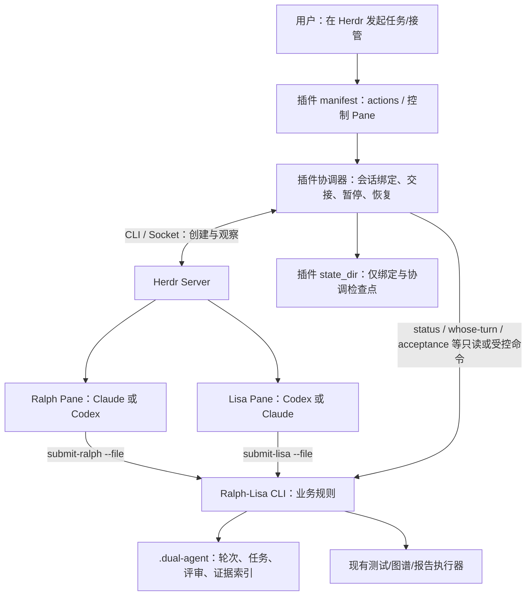

# Ralph-Lisa × Herdr 公开插件：产品范围、改造清单与工期估算

> 历史设计原稿（2026-10-28）。本文从早期内部产品对照迁入公开插件开发仓，保留当时的设计和条件估算，不能作为当前实现状态或排期。当前实施与验收以[公开仓开发方案](public-repo-herdr-plugin-start-2026-10-29.md)、[S1 宿主契约](public-cli-s1-host-contract-implementation-2026-10-29.md)及各阶段实测记录为准。文中的部分 `../../docs/` 链接指向原内部仓资料，在本公开仓不可用；仅作历史来源说明。

**日期：** 2026-10-28
**状态：** 基于仓库文档、当前源码和 Herdr 0.9.4 接口的实施设计；插件尚未开发、集成测试或发布。
**会议依据：** 已按时间顺序阅读 2026-10-27 飞书妙记逐字稿，聚焦其中的 Ralph-Lisa Loop 公开 Herdr 插件要求。转写把 Herdr、Ralph-Lisa、tmux 等名称识别成多种近音词，以下按上下文还原。内部会议链接未随公开仓迁入。
**会后口径（2026-10-29）：** 2026-10-28 复盘逐字稿明确**先插件、后独立客户端；插件从开放 Ralph-Lisa Loop 仓库开发，内部版能力只择要移植**。本文件之前按 `super-rll` CLI 所作改动与工期估算须经公开仓差异盘点后重估。
**当前实施起点：** 已隔离核对公开仓 `main` 的 `7440e29`、CLI `0.3.13`；与本仓 `0.50.4` 存在关键接口差异。请先按[公开仓开发起步方案](public-repo-herdr-plugin-start-2026-10-29.md)实施 S0–S5，本文保留职责、风险与验收的详细参考。
**讨论范围：** 首版仅 Claude Code 与 Codex；macOS 优先，随后验证 Linux。公开插件在 Herdr 终端内运行，不承诺独立桌面 GUI。

## 1. 插件目标与范围

Ralph-Lisa 的目标是把**任务、实施、适用验证、独立评审、证据和交付**连成可追溯的开发过程，而不是只把两个 Agent 放在相邻窗格里。现有 CLI 的 Ralph/Lisa 轮次、提交、评审、测试、验收和图谱仍是插件的业务核心；Herdr 提供两个真实 Agent 的工作区、窗格、终端、活动状态、人工接管与可观察的会话恢复能力。详见[产品总览](../../docs/RLL-OVERVIEW.md)、[操作手册](../../docs/RLL-OPERATIONS.md)。

本仓的[自适应自主开发章程](../../docs/rll-adaptive-autonomy-charter.md)与[自主开发实施计划](../../docs/design/autonomous-ai-dev-team-plan-2026-09-28.md)给出长期能力方向。实施计划明言自己是**草案，不是已实现清单**；插件首版只能以**公开仓实际具备**的 CLI 能力为基础，私有版接口需单独评估是否移植。

### 1.1 会议对插件的具体要求

| 逐字稿位置 | 对插件的要求 | 本文对应内容 |
|---|---|---|
| 29:06–29:59 | 先读 `super-rll` 产品文档，再详细说明现有 CLI/Ralph-Lisa 通信协议切到 Herdr 要改什么、多久 | 第 2、4、5、7、8 节 |
| 30:44–31:07、34:38–38:10 | 把 Ralph-Lisa Loop 的基础双 Agent 协作做成公开、可从 GitHub 安装的 Herdr 插件；首版集中 Claude/Codex；让 Herdr 替代 tmux 宿主，保留 RLL 业务循环 | 第 3、5、6、9 节 |
| 32:54–37:27 | 自动协作优先，用户可以中途介入；不要求靠手工执行每一轮 | 第 6、9 节 |

45:59 提到代码图谱“可以放进去”属于扩展设想，未定为插件首版必做功能。

本插件的“自动”特指：用户发起任务后，在已授权范围内自动完成 Ralph/Lisa 的**双席启动、轮次交接、提交评审、下一步通知与必要暂停**；无需用户手工执行每轮 `submit`/`go`。插件继续暴露现有 CLI 能力，但不会承诺 Super-RLL 尚未贯通的任意项目自主开发全流程。

### 1.2 首版刻意不包含

- 不提供原生项目看板、文件/PPT 预览、完整代码图谱 GUI 或独立安装的桌面窗口。插件可打开现有 CLI/HTML 报告或提供终端内简要状态页。
- 不重写 RLL 的评审、测试、门禁、验收、FDE 或图谱实现；也不建立第二套业务数据库。
- 不把 `ralph-lisa auto --full-auto` 启在 Herdr Pane 里。它会在内部创建 tmux 双窗，Herdr 只能看到外层进程，无法将 Ralph/Lisa 作为各自可观察的 Herdr Agent 席位。[Herdr Agent 说明](https://herdr.dev/docs/agents/)
- 不宣称“给任意项目即可无人值守开发完成”；当前仓库的[模块盘点](../../docs/design/autonomous-ai-dev-team-module-audit-2026-09-28.md)尚不支持这个首版插件承诺。

### 1.3 公开发布的依赖边界

插件首版只依赖可公开分发的 Ralph-Lisa CLI 契约及用户本机安装的 Herdr、Claude Code/Codex；不捆绑私有 Super-RLL 代码、资料或凭证。测试、图谱等现有能力只通过公开 CLI 入口提供；图谱是否增加插件专用交互另行评审。

当前工作目录的远程仓库为 `YW1975/super-rll`，仅作为内部产品与实现对照。2026-10-28 会议指定**开放仓库**为插件基础；已核对 [YW1975/Ralph-Lisa-Loop](https://github.com/YW1975/Ralph-Lisa-Loop) 主页为 Public、MIT，README 仍写自动模式需要 tmux，但尚未审计其最新源码、包版本或历史。P0 首先以公开仓为基线列出插件需要的 CLI 接口和可公开依赖，对照私有仓选择少量功能移植；必要协议若只在私有仓，需先取得公开授权或缩小插件功能。发布前核对代码结构、密钥/敏感文件和 Git 历史、许可证、构建脚本、默认分支的 `herdr-plugin.toml`、GitHub `herdr-plugin` topic 与安装路径。[Herdr Marketplace 规则](https://herdr.dev/docs/marketplace/)

### 1.4 仓库产品能力在插件中的落点

| 相关能力 | 仓库已有基础 | 插件处理方式 |
|---|---|---|
| 项目与需求输入 | `init`、任务/工作片、上下文、角色指令 | action 定位项目、启动当前任务；不新增通用任务理解引擎 |
| 文档理解、方案与设计 | Ralph/Lisa 轮次及设计/文档技能；图谱/影响分析入口 | 提供已有 CLI/技能入口；不重写文档与设计引擎 |
| 代码与单元测试 | CLI 后端启动、代码提交、选测、`test`/`gate` 和证据 | 复用测试执行器，显示真实结果；不自行判断测试通过 |
| Lisa 独立审核 | 协议 Lisa、`submit-lisa`、回执与共识 | 插件必须绑定正确 Lisa Session、具体版本和材料；这是公开双 Agent 循环的核心验收 |
| 端到端/应用验证 | WezTerm/Playwright/agent-e2e 等设施与报告 | 保留已有 CLI 入口；没有明确回执的项目验证不能被插件标为通过 |
| 部署/交付验证 | 发布迁移、验收和交付文档能力 | 保留现有授权和回执边界；插件自动交接不自动授予发布权限 |
| 过程查看与人工插入 | `status`、`recap`、测试报告、dev-tracker 等分散入口 | 在终端内显示轮次/失败/等待状态并接收用户指令 |

上述“已有基础”来自**本仓**[产品总览](../../docs/RLL-OVERVIEW.md)与[自主开发实施计划](../../docs/design/autonomous-ai-dev-team-plan-2026-09-28.md)，是公开插件的候选复用清单，**不代表公开仓也具备这些接口**，更不等于全自动生产链路已贯通。P0 需逐项标“公开仓已有 / 可移植 / 暂不移植”。对外宣传须以公开仓构建的真实样板任务回执为准。

## 2. 当前基线与证据边界

以下 `cli/src/*` 和产品文档均是 **`super-rll` 对照证据**；不能直接作为公开仓的实现承诺。公开仓的实际代码基线与差异审计列为 P0 第一项。

| 来源 | 当前可确认内容 | 对插件的含义 |
|---|---|---|
| 本仓 [README](../../README.md)、`cli/package.json` | 源码包版本 `0.50.4`；macOS/Linux 主入口 `auto --full-auto` 用 tmux，`auto --engine` 是无头独立入口 | 插件需要第三种运行宿主，不能把无头引擎当成两个 Herdr 原生席位 |
| [产品总览](../../docs/RLL-OVERVIEW.md) | 文档基于 2026-10-12 的 `0.50.2` 工作树；功能地图覆盖任务、评审、测试、验收、图谱、报告、FDE、平台等 | 用它确定产品边界，用当前源码确认具体实现；不要以旧文档版本覆盖新版本行为 |
| [CLI 操作手册](../../docs/RLL-OPERATIONS.md) | `submit-ralph`/`submit-lisa`、`whose-turn`、`status`、`task acceptance assess` 等已有入口 | 插件直接调用 CLI 接口，不复制判断逻辑 |
| [rll-term 接口契约](../../docs/rll-term-ralph-lisa-contract.md) | 已定义“终端协调器驱动窗格，RLL CLI 独占轮次状态”的薄宿主模式 | 可借鉴边界；其中有关 `RL_STATE_DIR` 与 tmux 的优先级说明须按当前 `state.ts` 复核，不能照搬旧注释 |
| 当前 [状态解析源码](../../cli/src/state.ts)、[提交桥](../../cli/src/engine/submissionBridge.ts) | 显式进程 `RL_STATE_DIR` 是优先状态来源；提交桥清理继承的 `TMUX`/`TMUX_PANE` | Herdr 启动的每一席必须绑定**绝对**状态目录和席位，防止串会话 |
| 当前 [tmux auto 实现](../../cli/src/commands.ts) | `cmdAuto` 不只建窗格，还初始化、校验、绑定两席、启动 watcher/supervisor/watchdog、处理日志/投递 | 替换工作是运行协调器迁移，不能按几个 tmux 命令估时 |
| 本机只读检查 | `herdr 0.9.4`，`herdr api schema` 为 `protocol=22`、`schema_version=1`；`herdr integration status` 显示本机 Claude/Codex 集成均未安装 | 可以据此设计和做静态接口检查；实际双席恢复须先在隔离环境安装集成并重新验收 |
| Herdr [插件文档](https://herdr.dev/docs/plugins/)、[Socket API](https://herdr.dev/docs/socket-api/) | 插件 v1 提供 manifest action、事件 hook、终端 Pane、启动 hook、CLI/Socket；没有原生非终端 UI 或托管存储 | 插件自管轻量绑定数据；长运行协调器不能假定由一次性 hook 托管 |

插件保持现有 CLI `.dual-agent` 为业务真源，不新增业务数据库。同一 RLL 会话只能由一个运行宿主驱动。

## 3. 插件与 CLI 的职责架构



**业务真源：** CLI 和项目 `.dual-agent`。插件绑定文件只记 `project_realpath`、RLL `session_id`、Herdr session/socket 身份、`workspace/tab/pane/agent_session`、席位、绑定代次、上次已处理的轮次/提交回执和协调器状态；不能保存一个可与 CLI 轮次冲突的“第二份 PASS”。同一用户可有多个 Herdr 命名会话，因此不能仅凭 `w1:p1` 或 Agent 显示名跨会话定位。

**Herdr 真源：** 当前 Pane、Agent、进程与可用的原生会话引用。`idle/working/blocked/done` 只表示 Agent 活动。`agent.prompt` 的成功只表示输入被接受或观察到状态变化；RLL 交接必须以 CLI 提交回执及再读业务状态确认为准。[Herdr Agent 自动化](https://herdr.dev/docs/agent-automation/)、[Socket API](https://herdr.dev/docs/socket-api/)

**单宿主规则：** 同一 RLL 会话只允许一个协调器。插件需要按 RLL 状态根申请原子宿主租约，并在启动时检查活跃 tmux watcher、已有插件控制 Pane 或其他写入者；旧 CLI 的 `auto`/`start`/无头入口也需识别这份租约，拒绝并发接管。租约过期只能在核对进程、Herdr session 和回执后回收，不能凭时间直接抢占。旧 tmux 模式与插件模式可在**不同项目/会话**中并存。

## 4. 现有能力：哪些不用改

| 产品能力 | 复用的现有实现 | 插件只需做的事 |
|---|---|---|
| 任务初始化、工作片、上下文 | `init`、`next-step`、`subtask`、`scope-update`、`context` | 提供 action 或 CLI 入口；显示执行错误；沿用 CLI 记录 |
| Ralph/Lisa 角色及提交格式 | 角色模板、`RL_AGENT_ROLE`、`session-role`、`[TAG]` 规范 | 启动时把角色环境准确给到两席；不重新解析/评判内容 |
| 轮次与独立评审 | `whose-turn`、`submit-ralph --file`、`submit-lisa --file`、`work.md`/`review.md`、CLI 回执 | 在合法轮次通知对侧；收到真实回执后再交接；Lisa 仍独立审阅 |
| 提交前检查和权限边界 | CLI 的 `submit-* --check`、实际 `submit-*`、后端许可/授权处理 | 将阻断原因显示出来；不以插件状态绕过预检或人工授权 |
| 测试、选测、报告和图谱 | `test`、`gate`、`impact-tests`、`test-report`、`graph` 等既有入口 | 可增加快捷 action/链接；结果由 CLI 的真实执行与证据解释 |
| 验收与收口 | `task acceptance show/record/run/assess`、`closeout-scope`、`recap` | 查询并显示 `accepted/failed/incomplete`；不从 Herdr `done` 推导验收 |
| FDE、Studio、Team Platform | 各自现有模块和成熟度 | 插件 v1 不改其领域规则；仅在以后有明确接入需求时做适配 |
| 原有 tmux 主入口与无头入口 | `auto`、`auto --engine` | 保持兼容；插件是独立入口，不默认改现有用户工作方式 |

复用不等于这些功能在任意项目均已全链路验收；具体执行器、后端、浏览器/设备和外部通道仍按项目环境检查。[产品总览的边界说明](../../docs/RLL-OVERVIEW.md)

## 5. 必须改：tmux 与 watcher 的七个接缝

| 现有 tmux 路径 | Herdr 插件实现 | 需改动位置/风险 |
|---|---|---|
| **1. 双席启动**：`cmdAuto` 生成 tmux session、split-window、`send-keys` | 插件 action 创建 Workspace/Tab/两个 Pane，从返回值保存 ID；只启动 Claude/Codex；用 Herdr 的 Agent 识别和启动能力 | 新增插件 launcher；复用 `backend-launch.ts` 的后端解析/权限/trust 规则，必要时抽出可供插件调用的结构化启动契约。`agent start` 要求现有 Pane 处于空闲 shell 提示符，成功返回才表示检测到可输入 Agent；`agent_not_ready` 和登录/权限阻塞须单列，不能手写两条裸 `claude`/`codex` 命令代替现有安全配置 |
| **2. 席位身份**：tmux `%N` 和 `seat-pane`/launch record | 绑定 `project_realpath + RLL session_id + Herdr session + role + workspace/pane + agent_session + generation`；每次投递前再核对实时 Agent | 新增 Herdr seat registry **及 CLI 可核验的 Herdr 来源**；当前 `seat-identity.ts` 的绑定核验是 tmux 专用，`RL_AGENT_ROLE` 可被继承，不足以单独证明席位。Pane 移动会改变公开 ID，Server 重启可能改变 Terminal/Pane ID，不能凭窗格序号或显示名发消息 |
| **3. 输出与活动**：`capture-pane`、`pipe-pane`、watcher 的 busy/permission 检查 | `agent.get/read/wait`、`pane.read`、Socket 事件订阅与状态快照；原始日志限量留存 | 新增观察适配器。订阅中任一 Pane ID 已失效会拒绝整组订阅；`events_lost` 后须先新订阅并等待 `subscription_started`，再从另一连接取快照。Herdr 屏幕识别可误把新权限提示判为 idle，`idle` 不等于授权；插件不靠屏幕 `[PASS]` 字样修改业务轮次 |
| **4. 轮次交接**：watcher 读 `turn.txt/round.txt`，发送“轮到你” | 订阅/监控提交回执及 CLI 状态，生成唯一交接意图；核实轮次、目标身份和对侧可接收后 `agent.prompt` | 新增长运行协调器；以 CLI 回执为准，状态事件只负责唤醒。提示投递的超时/断线为未知结果，不自动重复发同一轮 |
| **5. 人工输入**：tmux 终端与 watcher `control.txt` | Herdr 原生 Pane 供用户直接查看；插件 action 提供状态、**先暂停再人工输入**、恢复、停止、发送受控消息 | `pane.focused` 事件没有客户端身份，且已选中 Pane 再聚焦不产生事件；插件不能仅凭焦点识别所有用户键入。P0 必须验证能否提供可靠的接管/输入租约，否则首版只承诺“显式暂停后的人工输入”，不能宣称任意时刻无冲突接管。范围变更仍调用 CLI |
| **6. 存活与恢复**：watcher supervisor/watchdog、心跳、PID、session 记录 | 控制 Pane 中运行可观察的协调器；启动 hook 只做一次性检查/恢复提示；连接失效后订阅并重新读取快照 | 插件不能把一次性 `[[startup]]` 当作常驻 daemon。Server 重启后旧进程消失；先重核 Claude/Codex 原生会话、RLL 轮次与未决投递，再安全续跑或暂停人工确认 |
| **7. 诊断与日志**：`watcher.log`、`pane0.log`、`pane1.log`、`doctor` | CLI 业务状态 + Herdr Agent 状态 + 插件控制日志分别显示；给出“运行中、阻塞、投递未知、协调器停止”等明确原因 | 新增插件诊断/终端状态 Pane；只保留所需日志并限制大小/敏感信息，不把屏幕文本当交付证据 |

**重要依赖：** 当前 `cmdAuto` 在 [commands.ts](../../cli/src/commands.ts) 中混合了初始化、后端启动、tmux 座位绑定及很长的 watcher 脚本。首版建议**新增插件宿主**，把确需共享的后端启动/提交结果抽成小接口；不要直接编辑 watcher 内所有 `tmux` 字符串。`auto --engine` 使用独立 `TurnCoordinator` 和 ACP/其他传输，直接运行会使 Claude/Codex 离开 Herdr Pane，不能充当本插件的双席实施。[autoEngine 源码](../../cli/src/engine/autoEngine.ts)

## 6. 插件内部设计与接口

建议将公开包放在经核实的**公开 Ralph-Lisa Loop 仓库**的 `integrations/herdr-plugin/`，或另建仅依赖公开 RLL CLI 的公开仓库；当前 `super-rll` 目录只保存设计与私有产品集成工作，不把它作为默认公开源。实际目标仓库和需抽出的公共 CLI 契约在 P0 固定。插件包内：

```text
herdr-plugin.toml          manifest，声明 actions / startup / 控制 Pane
package.json / lockfile      若用 Node 构建，记录可复现依赖和构建命令
src/launch.ts              CLI 预检、Herdr Workspace/Pane 创建、Agent 启动
src/bindings.ts            席位绑定、代次与实时身份复核
src/coordinator.ts         监听轮次、投递意图、暂停/恢复与超时
src/herdr-client.ts        CLI 包装 + 必要的 Socket 订阅/快照
src/rll-client.ts          调用已安装 ralph-lisa CLI，解析机器回执
src/doctor.ts              依赖、集成、状态所有权和日志诊断
src/control-pane.ts        Herdr 终端内状态/人工操作入口
tests/                     隔离项目里的契约、故障与真实双席测试
```

Manifest 的 `[[actions]]` 可声明 `start`、`status`、`pause`、`resume`、`stop`、`open-report`；`[[panes]]` 提供**非 popup**控制 Pane，使协调器随 Pane 生命周期受 Herdr 管理。`[[startup]]` 仅重读绑定并提示/触发可证明安全的恢复，不后台藏一个无限进程。Herdr 插件配置目录保存用户选项，插件状态目录只保存运行绑定。Herdr 插件的命令是 argv 数组，运行时可用 `HERDR_BIN_PATH`、`HERDR_PLUGIN_CONTEXT_JSON`、`HERDR_PLUGIN_STATE_DIR`；首次发布时根据实际用到的接口设置准确的 `min_herdr_version`。[插件文档](https://herdr.dev/docs/plugins/)

`start` action 是短命入口：完成项目/会话预检后通过 `HERDR_BIN_PATH` 打开 `control` Pane；控制 Pane 内的进程持有自动协调循环。插件安装对当前用户的所有 Herdr 会话全局可见，运行绑定仍须按项目真实路径、RLL 会话和 Herdr 命名会话隔离。

### 6.1 对照 Herdr 插件 v1 的发布契约

下面是**拟实现的 manifest 示例**，尚未运行 `plugin link/install` 验证；`min_herdr_version` 在 P0 依据实际使用的字段和 API 固定，不能直接照抄示例版本。

```toml
id = "ralph-lisa.loop"
name = "Ralph-Lisa Loop"
version = "0.1.0"
min_herdr_version = "0.9.4"
description = "Run the Ralph-Lisa dual-agent workflow in Herdr"
platforms = ["macos"]

[[build]]
command = ["npm", "ci"]

[[build]]
command = ["npm", "run", "build"]

[[actions]]
id = "start"
title = "Start Ralph-Lisa task"
contexts = ["workspace"]
command = ["node", "dist/action.js", "start"]

[[actions]]
id = "status"
title = "Show Ralph-Lisa status"
contexts = ["workspace"]
command = ["node", "dist/action.js", "status"]

[[panes]]
id = "control"
title = "Ralph-Lisa control"
placement = "tab"
command = ["node", "dist/control-pane.js"]

[[startup]]
command = ["node", "dist/startup.js"]
```

| Herdr 官方要求 | 本方案要落实的做法 |
|---|---|
| manifest 必填 `id/name/version/min_herdr_version`，声明目标 `platforms` | 用稳定插件 ID；首版仅 `macos`，Linux 验收后再扩；action/pane ID 在插件内唯一且不含点号 |
| `command` 是 argv 数组，不经过 shell | 脚本自行处理参数与路径；不在 TOML 中使用 `~`、`$VAR` 或 shell 拼接 |
| `[[build]]` 只在 GitHub `plugin install` 时、预览后注册前执行；`plugin link` 不构建 | 发布包带锁文件；本地开发先自行构建再 `plugin link`；构建不能改动预览后的 manifest |
| 运行命令工作目录是**插件目录** | 从 `HERDR_PLUGIN_CONTEXT_JSON` 及 Workspace/Worktree 快照解析用户项目，再校验真实路径；不能用 `process.cwd()` 当项目目录 |
| 运行时注入 `HERDR_BIN_PATH`、`HERDR_PLUGIN_ROOT/CONFIG_DIR/STATE_DIR`、上下文和可用 Pane ID | Herdr 命令优先走 `HERDR_BIN_PATH`；配置/凭证引用在 config 目录，绑定与投递意图在 state 目录；安装根目录不写持久数据 |
| manifest Pane 默认 `overlay`；`popup` 无 Pane ID、生命周期事件或持久化 | 控制器显式使用 `placement = "tab"` 的普通 Pane；启动后验证实际 Pane 和进程，关闭即停止自动投递；popup 只适合短暂交互 |
| `[[startup]]` 是 Server 启动/切换时的一次性 hook，链接、启用或客户端附着不会触发 | 只重核/提示恢复；首次链接后由用户 action 显式启动控制 Pane；不靠启动 hook 托管 daemon |
| startup 失败不会阻止 Herdr Server 启动；插件命令有单独日志 | `doctor/status` 检查上次启动与控制 Pane 状态，给出可见修复操作，不能把 Server 正常启动误报为协调器已恢复 |
| 更新/卸载保留旧安装与 config/state，运行进程不会自动切换到新版 | 新旧协调器不得同时持有同一会话；升级时核对宿主租约、版本和状态格式，旧 Pane 退出后才由新版本接管 |
| 插件进程必须在父命令/Pane 退出前清理自己启动的后台进程 | 协调器留在受 Herdr 管理的控制 Pane 前台；子进程由其监督、退出时清理；Claude/Codex 席位属于 Herdr，不由插件卸载时暗中杀掉 |
| 市场发现依赖公开 GitHub 仓库、默认分支中的可解析 manifest 和 `herdr-plugin` topic | 发布前检查许可证、GitHub topic、默认分支路径；验证 `herdr plugin install owner/repo[/subdir] --ref <tag>`，市场收录不等于官方安全审核 |

Herdr 会记录插件命令日志，安装时的 `[[build]]` 与运行命令都以用户权限执行，也不会由 Herdr 沙箱隔离。插件不能向 stdout/stderr 打印用户提示全文、凭证或私有代码；公开安装说明需列出构建工具、依赖与权限影响，固定依赖版本并审阅构建脚本。Herdr 的 `[[events]]` 是**按事件启动命令的 manifest hook**，不能当作持久事件队列或常驻协调器；本方案由控制 Pane 进程订阅 Socket 事件，断线时重新订阅并取快照。`plugin update` 读取安装时记录的 Git ref；若用不可变 tag 锁定版本，升级到新 tag 需要重新安装指定新 ref，不应宣称普通 `plugin update` 会自动跨 tag。[插件生命周期](https://herdr.dev/docs/plugins/)

Socket 订阅的恢复顺序必须具体化：重新连接 → 建立新订阅并等 `subscription_started` → 另一连接读取 `session.snapshot` → 将事件只当作缓存失效通知并串行重读。快照与事件没有共同的序号边界，不能把积压事件直接叠到快照上；Pane 迁移后先刷新 ID，再重新建立过滤订阅。[事件订阅契约](https://herdr.dev/docs/socket-api/)

官方参考：[Plugins](https://herdr.dev/docs/plugins/)、[Marketplace](https://herdr.dev/docs/marketplace/)。本机只读复核：`herdr 0.9.4`、`plugin install` 支持 `--ref`、`plugin pane open` 支持 `tab` placement；Claude/Codex Herdr 集成目前均未安装。上述 manifest 仍是设计草案，须在隔离配置中实际链接和安装验收。

### 6.2 关键状态协议

1. `start` 从 Herdr 传入的 Workspace/Worktree 上下文确定项目，解析真实路径，确认 `ralph-lisa` 版本、Claude/Codex 可执行与认证、Herdr schema、RLL 会话/授权范围，并拒绝同会话已有活跃 watcher。插件命令的当前目录是插件安装目录，不能当作用户项目。
2. 通过现有 CLI 初始化或进入已核验的会话；读取 `.session-anchor`/轮次，不以 Herdr 工作区名作为业务 Session ID。
3. 创建两席时显式传 `RL_STATE_DIR=<绝对路径>`、`RL_AGENT_ROLE=ralph|lisa` 和当前 `RL_SESSION_ID`，并清理从外层 tmux 继承的 `TMUX/TMUX_PANE`；核对实际进程继承环境。Herdr `agent start` 目前不单独接收 `--env`，环境须在创建 Workspace/Pane 时传入，或由受控启动器以结构化环境启动；此项需要端到端实验。当前 CLI 的[席位解析](../../cli/src/seat-identity.ts)不能把环境变量单独当权威，实施时必须给它增加经 Herdr Server 与绑定代次核验的来源，或等价的机器契约；不能通过给每次自动提交加 `--seat` 假装用户确认。Server 重启后的原生 Agent 恢复也必须重验环境与席位来源，不可只验会话 ID。[Herdr Agent 自动化](https://herdr.dev/docs/agent-automation/)
4. 协调器只在“CLI 指示当前席位 + 绑定身份匹配 + 目标 Agent 已可接收且非 `blocked/unknown` + 无待处理权限/显式人工暂停 + 无同轮投递记录”时发提示。Herdr 允许给 `working` Agent 发送 prompt，但本插件默认等待当前工作结束并复核业务轮次，以免旧轮次输入排队混入。**未经显式暂停的用户直接键入无法仅靠焦点事件可靠识别**；P0 若拿不到可验证的独占输入约束，不能承诺“任意时刻输入绝不冲突”。投递前后再读 CLI 轮次和 Herdr 席位。状态跃迁依据 `submit-*` 的真实回执或 CLI 提交记录；`agent.wait`/`done` 只作辅助观察。
5. `agent.prompt`/Socket 断开、超时或返回模糊结果时写 `needs_reconcile`，检查目标 Pane 输出、Agent Session、CLI 回执及轮次；无法证明未投递时不自动重发，提示用户核对。
6. 插件暂停/停止只停止**协调器自动投递**；终止 Agent、关闭 Pane、删除 `.dual-agent` 或撤销用户工作分别是独立动作，不能在 `stop` 中静默发生。

### 6.3 恢复分层

| 场景 | 安全动作 |
|---|---|
| 用户退出 Herdr 客户端，Server 仍在 | 原进程和 Pane 继续；重新附着后快照核对，控制 Pane/协调器继续 |
| 插件控制 Pane 退出 | 自动投递暂停；现有 Agent/CLI 业务文件保留；重新打开控制 Pane 后从真实状态恢复，避免双协调器 |
| Herdr Server 重启 | 原进程已消失；需安装相应 Claude/Codex 集成并满足原生会话恢复条件；获取新快照、重绑身份和代次，再恢复交接 |
| 事件丢失或 Socket 断开 | 重新订阅，读取权威快照和 CLI 状态；不能仅用增量事件回放推断当前轮次 |
| 权限提示或用户显式暂停接管 | 暂停自动提示；显示可见原始提示，用户在终端处理后再核对轮次；未经显式暂停的直接键入属于 P0 待验证的冲突边界；`--full-auto` 不扩大对外发送/发布权限 |

Herdr 官方说明：客户端脱离时进程继续；**Server 重启时原进程不继续**，只有满足原生会话恢复条件的 Agent 会话可重启。事件订阅也不是持久日志；落后时会报 `events_lost`，必须重取快照。[会话恢复](https://herdr.dev/docs/session-state/)、[Socket 事件](https://herdr.dev/docs/socket-api/)

### 6.4 实施前要冻结的最小机器契约

下表是**拟定的字段和语义**，不是声称当前 CLI 或 Herdr 已按此格式输出。P0 先检查现有结构化回执；缺字段时只补最小只读接口，并记录具体命令、示例和版本。

| 契约 | 最少字段/行为 | 使用方与失败处理 |
|---|---|---|
| RLL 会话快照 | `project_realpath`、`session_id`、当前 `turn/round`、业务修订或可比对的提交代次、阻断原因 | 协调器每次投递前后读取；项目/会话不一致则停止 |
| 提交回执 | 提交 ID、席位、材料版本/哈希、提交后的轮次/修订、`accepted/rejected/unknown` 及原因 | 只有 `accepted` 且回读状态一致才自动交接；`unknown` 进入核对 |
| Herdr 席位快照 | Herdr 命名会话、Workspace/Pane、Agent 类型、原生 Agent Session、当前进程/活动状态、绑定代次 | 投递前与持久绑定比较；重建或身份变化则重新绑定，不沿用旧 Pane ID；CLI 提交也须能核验同一席位来源 |
| 投递意图 | `project_realpath + session_id + round + target_role + source_receipt_id` 唯一键、目标绑定代次、尝试时间、投递观察结果 | 同一键禁止并发发送；超时不视为失败后立即重发 |
| 宿主所有权 | 状态根真实路径、会话 ID、宿主类型、进程/启动代次、租约心跳与核验方式 | 旧 CLI 和插件启动/续跑共同检查；无法验证持有者时暂停人工核对 |

**交接时序：** 收到/轮询到提交变化 → 读取 RLL 快照与提交回执 → 建立唯一投递意图 → 重核 Herdr 席位和人工接管状态 → 发送提示 → 再读 RLL 状态及目标 Agent 观察。Herdr 事件只是唤醒信号；RLL 回执决定是否进入下一轮。若投递与快照读取之间断线，保留 `needs_reconcile` 和原始键，重启后先查目标会话和业务轮次，不生成新键绕过旧意图。

**P0 的可审查产物：** 一份固定版本/命令的接口清单、Claude/Codex 各一笔真实启动和提交回执、两席环境变量继承记录、Server 重启前后身份对照、已有 CLI 回执缺口表、宿主冲突方案及据此修订的工期。任一基础契约无法安全满足时，不进入 P2 的自动双席启动。

## 7. 源码变更清单与兼容策略

| 范围 | 预期动作 | 是否改现有源码 |
|---|---|---|
| 新插件目录 | manifest、Herdr 客户端、控制 Pane、协调器、隔离测试、安装说明 | **新增** |
| `cli/src/backend-launch.ts` 与后端注册表 | 若现有导出不能完整提供 Claude/Codex 的 argv/env/权限/trust，则抽稳定的结构化读取接口；不得在插件再造后端规则 | **小范围改造，待 P0 验证** |
| `cli/src/cli.ts`、`commands.ts` | 建议新增 `herdr` 或 `host-contract` 机器可读只读入口（会话、合法席位、提交结果、阻断原因）；保留原命令语义 | **可能新增小接口**；先验证现有输出/回执是否足够，避免为了插件重构主入口 |
| CLI 宿主所有权与席位来源 | 新增可核验的 Herdr 宿主租约，插件、`cmdAuto`、`cmdStart` 与无头入口在启动/续跑前做冲突判断；扩展 `seat-identity.ts` 等提交入口，使其可验证 Herdr 会话、Pane/Agent、RLL 会话和绑定代次；旧版本 CLI 不懂此契约时插件应拒绝启动 | **必须改造**；P0 要核对所有受影响命令，工作量可能超出原“小范围”估计 |
| `cli/src/state.ts`、`submit-*`、`task acceptance`、`test`、`graph` | 沿用权威状态、提交、验收、验证规则 | **原则上不改**；仅修集成发现的实际契约缺口 |
| `cmdAuto` watcher/supervisor/watchdog、`seat-pane` | 旧 tmux 模式继续使用；插件不调用其 tmux 路径 | **不做整块替换或删除**，防止旧用户回归 |
| `auto --engine`/`TurnCoordinator` | 保持独立无头模式 | **不改**；未来若抽共同宿主接口须另立兼容任务 |
| 角色模板/安装同步 | 如需让 Agent 明确识别插件宿主与提交时机，只补最小宿主说明；仍通过 `RL_AGENT_ROLE` 辨识 | **可能小改**，需验证旧 tmux/daemon/engine 不变 |
| 文档与发布元数据 | 新增安装、依赖、权限、恢复、卸载、支持版本和公共插件 README | **新增**；公开 GitHub 插件须有可安装的 manifest、许可证与版本标签 |

机器接口优先取 CLI 已有回执。长期依赖 `work.md`、`review.md`、`history.md` 的内部文本格式会脆弱；[rll-term 契约](../../docs/rll-term-ralph-lisa-contract.md)明确这些不是稳定接口。若 P0 发现回执无法唯一识别轮次/提交，应先给 CLI 加只读 JSON 契约，再继续插件实现。

### 7.1 可拆分的代码交付单元

| 工作单元 | 输入依赖 | 完成时必须能展示 |
|---|---|---|
| 插件安装与诊断 | 公开包边界、Herdr manifest 版本 | 新机器安装、版本不匹配/未登录/缺集成的明确错误 |
| CLI 宿主契约 | 会话快照、提交回执、后端启动配置 | 旧 tmux 与插件在不同项目可运行；同会话冲突被拒绝 |
| Herdr 双席适配 | 结构化启动环境、Agent/Pane 快照 | Ralph/Lisa 身份可验证，移动或重启后旧引用失效 |
| 自动交接控制器 | CLI 回执、投递意图、单宿主租约 | 成功与 `NEEDS_WORK` 两条真实路径无需手工逐轮驱动 |
| 恢复与诊断 | 持久绑定、Herdr 快照、CLI 状态 | 断线/重启/未知投递时安全续跑或停在可解释状态 |
| 发布包与兼容 | 上述单元及 README | 公开安装/更新/卸载、旧 tmux/engine 回归和故障案例记录 |

## 8. 实施顺序、工期与前提

下表保留 2026-10-28 按 **`super-rll` 对照接口**所作的原条件估算，**现在不能作为公开仓实施排期或报价**。2026-10-28 会议已指定公开仓为实施基础；须先完成公开仓代码/历史/发布审查、与私有仓的接口差异和选择性移植清单，再重估。原估算假设一名熟悉 Node/TypeScript、RLL CLI 和 Herdr 的工程师全职投入，现有 Claude/Codex 可正常登录，目标先为 macOS，且不同时开发定制 GUI；外部认证/审批等待不计入。

| 阶段 | 工作与可验收结果 | 估算 |
|---|---|---:|
| P0 公开仓基线与接口冻结 | 先审计公开仓源码、历史、许可证、发布文件和凭证风险；对照内部版列必要门禁与候选移植。再固定 CLI/Herdr 版本；隔离环境验证 manifest `link`/Pane `tab`、运行上下文与构建、`--env` 和 tmux 环境清理、Agent 启动、CLI 席位来源、真实提交回执、Pane ID 变化、人工直接输入冲突；列机器接口缺口 | **待重估**（原 2–3 人日不含公开仓审计/差异） |
| P1 插件骨架 | 必填 manifest 字段、锁文件与构建、安装/链接、依赖诊断、项目与会话选择、动作日志；不启动完整循环 | 2–3 人日 |
| P2 双席启动 | 复用后端配置与角色环境，创建/绑定 Claude、Codex 两个真实 Herdr 席位；实现 CLI/插件共用的宿主冲突检查 | 3–5 人日 |
| P3 自动交接 | 控制 Pane、CLI 回执/轮次监听、单轮投递、重复抑制、暂停/恢复、阻断与人工接管 | 5–8 人日 |
| P4 诊断与现有工具入口 | 状态、测试/验收/报告快捷入口，日志边界和错误提示；区分 Agent 活动、提交、评审和验收 | 2–4 人日 |
| P5 故障与恢复 | 断线、事件丢失、重启、Pane 移动、投递未知、旧 watcher 冲突和双控制器防护 | 4–6 人日 |
| P6 插件宿主发布验证 | Claude/Codex 真实双席成功/失败案例、旧 tmux/engine 回归；GitHub shorthand 安装/更新/卸载、旧 Pane 不自动换版、README/许可证/版本/topic 与公开安装检查 | 3–5 人日 |
| **P0–P6 合计** | **可公开安装的基础双 Agent 自动协作插件，不含 Super-RLL 全流程产品化** | **待重估**（原条件估算 21–34 人日、约 4–7 周） |

**演示切片：** 原 P0–P3 估算 **12–19 人日**，公开仓基线确定前同样**不能用作当前排期**。可展示的结果必须是 Herdr 双席和公开 CLI 的真实自动交接；只创建两个 Pane 的布局演示不能称为 Ralph-Lisa 插件。

**估算可信度修正：** 除公开仓差异外，CLI 席位来源改造与人工直接输入约束也尚未通过实验。P0 若表明必须跨多入口重构席位身份，或 Herdr 无法保证首版接管语义，就要先调整功能承诺和工期。是否将 Herdr 版升为公开仓 `main`、最终删除 tmux，是会议中的**待评估提议**；本方案先保留旧模式回归和回退，不能提前宣称已决定停用 tmux。

此工期只覆盖本文插件的开发和验收。

## 9. 必须通过的验收案例

1. **正常闭环：** 用户在 Herdr 给当前项目一项可由现有 CLI 处理的任务 → 插件自动启动两席并投递任务 → Ralph 提交真实材料 → 插件自动通知 Lisa → Lisa 独立审查并提交 `PASS` 或 `NEEDS_WORK` → 插件自动通知下一席或停在明确状态；CLI 的实际测试、评审与验收结论可查询。每一步有 CLI 回执和目标席位。
2. **失败仍可见：** 测试失败、提交被门禁拦截、验收 `incomplete`、Agent `blocked` 分别显示，任何一种都不自动标“完成”。
3. **身份错位：** 两 Pane 交换、移动、重建或同名 Agent 重启后，旧绑定不能继续投递；其他项目的 Pane 不受影响。
4. **投递不确定：** 发送前后轮次变化、`agent.prompt` 超时/Socket 断开、控制 Pane 崩溃重启时，不重复提示或跨轮提示；无法判明时停在 `needs_reconcile`。
5. **恢复：** 客户端退出重连可续跑；Server 重启后在安装集成且身份可核实时恢复，不可核实时安全暂停并给出修复操作。
6. **人工接管：** 用户通过插件显式暂停后，协调器不抢输入；用户可恢复并查看原始提示。用户在未暂停时直接向同一 Agent Pane 键入，须在 P0 证明可检测/仲裁后才能纳入无冲突承诺。
7. **旧模式兼容：** 现有 `auto --full-auto` tmux 与 `auto --engine` 在各自隔离项目中行为不回退；插件从不清理它们的会话。
8. **公开安装：** 全新用户按 README 安装 Herdr、公开 RLL CLI、Claude/Codex 并登录后，可审阅 manifest，用 `herdr plugin install owner/repo[/subdir] --ref <tag>` 安装并更新/卸载；`plugin link` 本地开发需先构建。默认分支、`herdr-plugin` topic 和可解析 manifest 满足市场发现条件；旧运行 Pane 不自动切换到新代码，不能出现双协调器。插件不依赖私有 Super-RLL 源码或凭证；未安装集成时功能与恢复限制被准确提示。
9. **自动协作：** 成功、Lisa 要求修复与用户中途纠正三条路径在现有 CLI 能力范围内自动交接；控制 Pane 能解释轮次、失败及等待原因，手工逐轮驱动不是完成这些案例的前提。

真实 Claude/Codex 和 Herdr 双席验证要在**隔离项目/会话**中完成；本设计文档没有运行上述 P0–P6 验收，也没有修改现有 CLI 源码。

## 10. 插件风险与实施决策

| 风险/问题 | 处理建议 |
|---|---|
| Herdr 插件 v1 仅有终端 UI | 以终端内的双 Agent 协作、状态和人工接管作为公开插件的可验收体验 |
| `cmdAuto` watcher 代码和业务副作用交织 | 不整体替换旧主入口；为插件建立薄宿主，复用 CLI 规则；以 P0 调用链核对结果确定最少 CLI 改动 |
| Herdr 的 Agent 状态与 RLL 完成状态不同 | 始终显示来源及语义；CLI 提交/验收为业务真源，Herdr 状态仅用于观察与交互 |
| Herdr Server 重启、事件丢失、未知投递 | 身份重核、快照重取、单轮投递记录；无法证明时暂停，不自动猜测 |
| 公共插件运行权限 | Herdr 插件按当前用户权限执行，安装前要展示 manifest 与脚本；凭证沿用用户自己的 Claude/Codex，不写入插件源代码或公开日志。[插件安全说明](https://herdr.dev/docs/plugins/) |
| 本机 Claude/Codex Herdr 集成尚未安装 | 先在隔离配置/演示环境完成 P0，不把已有架构原型的验证直接当作公共插件验收 |

**建议先做 P0：** 从公开 [Ralph-Lisa-Loop](https://github.com/YW1975/Ralph-Lisa-Loop) 仓库核对真实代码、历史与发行包，选择必要功能并验证 CLI–Herdr 的启动、寻址、交接和恢复契约；据结果重新估算。公开仓的 fork 若来自公共上游，在 GitHub 上也保持公开，不能把“fork 后改私有”当作开发隔离方案。[GitHub fork 规则](https://docs.github.com/en/pull-requests/reference/forks)
