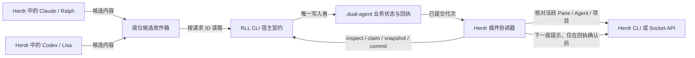

# S1 实施方案：公开 Ralph-Lisa CLI 的 Herdr 宿主契约

**日期：** 2026-10-29
**最近更新：** 2026-10-30

**状态：** 分阶段实施中；原始基线为公开仓 `main@7440e29`、CLI `0.3.13`，各切片的实际完成情况以下文和 GitHub CI 为准。本文不是完整交付回执。
**位置：** [六阶段开发顺序](public-repo-herdr-plugin-start-2026-10-29.md)中的 S1。后续 S2 才做 Herdr 插件壳，S3 才做真实 Claude/Codex 双席交接。

**开发位置与分支：** 本公开仓已在独立工作目录 `Ralph-Lisa-Loop-herdr/` 检出；S0 基线至代次基线的开发分支已推送开发 fork，且对应 CI 均成功。当前在 `feat/herdr-s1-candidate-inbox` 切片分支；S1 尚未完整交付，也没有向原仓提交 PR。完整分支表见[开发起点第 3 节](public-repo-herdr-plugin-start-2026-10-29.md#3-先建怎样的开发分支)。

## 1. S1 要交付什么

让一个外部协调器能够安全回答四个问题，并以机器可核验的方式提交一轮：

1. **这是哪个项目和哪次 RLL 会话？** 使用项目与状态目录的规范路径、稳定 `session_id`，避免从当前目录猜错项目。
2. **谁在管理会话，谁是 Ralph/Lisa？** 同一会话只能有一个有效协调宿主；保存两席与 Herdr Pane/Agent 的绑定及版本。绑定数据由协调器写入并复核，不把 Agent 自报的环境变量当作身份凭证。
3. **现在允许哪一席提交？** 读取一致的轮次快照；提交时再核对预期代次、角色、席位、正文摘要和现有 policy/test gate。
4. **本次提交到底发生了吗？** 给每次正式提交一个稳定请求 ID、只读回执和明确的不确定状态；相同请求不能再次写入历史或推进轮次。

**范围边界：** 保留公开 CLI 原有人工 `submit-ralph`、`submit-lisa`、`whose-turn`、`status` 体验及默认 `start`/`auto`。S1 不把 tmux watcher 改成 Herdr，也不移植其他产品版本的全部状态、测试或验收功能。Herdr 插件只通过此契约使用 RLL 的业务状态。

## 2. 已核对的代码事实及需要改动的原因

| 公开仓现状 | 具体影响 | S1 处理 |
|---|---|---|
| `cli/src/cli.ts` 的 `init` 实际分派到 `cmdInitProject`，后者最终调用 `cmdInit`；`cmdInit` 会删除现有 `.dual-agent` | 宿主重新启动时若误调 `init`，会丢失现有会话 | 宿主只对空项目显式初始化；对已有会话先 `inspect`，绑定后禁止覆盖性 `init` |
| `state.ts` 优先读 tmux 的 `RL_STATE_DIR`，再读环境变量，最后向上找 `.dual-agent` | 从 Herdr Pane 或插件工作目录运行时可能定位到别的项目 | 机器接口必须显式传 `--project` 或 `--state-dir`，解析规范路径后校验 `.project_root`；禁止隐式回退 |
| 两个 `submit-*` 只检查 `turn.txt`，随后顺序写 `work.md`/`review.md`、`history.md`、`last_action.txt`、`turn.txt`，Lisa 还更新轮次和死锁计数 | 并发时可能双提交；进程崩溃后可能留下部分写入；终端文字不足以作为提交回执 | 共用一条提交事务入口：互斥、预检、事务记录、写入、校验、不可变回执；中断时进入 `needs_reconcile` |
| policy 检查存在；Ralph `[CODE]`/`[FIX]` 的 `runGate` 仅在 `RL_RALPH_GATE=true` 时执行，默认关闭 | 不能因为接入 Herdr 就宣称测试门禁自动开启 | 沿用现有门禁配置和阻断语义；回执记录 policy/gate 的执行与结果，不默默改默认值 |
| `auto` 有 tmux watcher 和 `watcher.pid`；`force-turn` 只对 auto watcher 有保护；`step`、`stop`、`clean`、`uninit` 等也会改状态 | 同一 `.dual-agent` 被 tmux 与 Herdr 同时驱动，或绕过宿主检查 | 为所有会改变会话或删除会话的入口增加宿主占用检查；tmux 模式只在未被 Herdr 占用时工作 |

公开基线：[CLI 分派](https://github.com/YW1975/Ralph-Lisa-Loop/blob/7440e29/cli/src/cli.ts)、[状态解析](https://github.com/YW1975/Ralph-Lisa-Loop/blob/7440e29/cli/src/state.ts)、[提交及 auto](https://github.com/YW1975/Ralph-Lisa-Loop/blob/7440e29/cli/src/commands.ts)。

## 3. 进程与信任边界



Herdr 官方接口能管理 Pane/Agent 并返回创建时的 ID；插件动作具有 `HERDR_PLUGIN_CONTEXT_JSON` 等上下文。但这些值是**调用上下文**，不是能抵御同一用户权限下恶意进程的安全令牌；Herdr 插件本身也没有沙箱。[官方插件文档](https://herdr.dev/docs/plugins/) · [Agent 自动化](https://herdr.dev/docs/agent-automation/)。因此 S1 的目标是防错项目、错席位、重入和崩溃误重放，不宣称隔离恶意本地 Agent。

**默认交付路径：受控提交。** Agent 只写候选内容；协调器依据 Herdr 活跃席位、RLL 快照和候选内容调用 `host commit`。宿主绑定状态下直接运行传统 `submit-*` 应明确拒绝，提示改用候选提交入口；未绑定的人工会话保持原行为。这样正式提交不会只依赖 `RL_AGENT_ROLE`、`HERDR_PANE_ID` 等可继承或自报的值。候选来源仍需在 S3 真机验证；若无法可信归因某个候选，暂停交接并请用户确认，不自动推进。

## 4. 文件布局与状态模型

建议在公开仓 `.dual-agent/` 内新增**仅用于宿主契约**的目录；不移动既有 `task.md`、`work.md`、`review.md` 等文件：

```text
.dual-agent/
  session.json                 # schema、session_id、规范项目路径、创建时间
  host/
    binding.json               # 宿主类型、Herdr workspace、两席 Pane/Agent、绑定代次
    adoption.json              # 旧会话接管记录与人工确认结果
    adoption-backups/<id>/     # 接管前关键业务文件的逐字节备份
    lease/record.json          # 原子目录占用；owner_id、lease_id、领取时间及心跳序号/时间
    lease/record.pending       # 心跳原子更新的临时文件；遗留时冻结
    retired-leases/<lease-id>/ # 显式恢复时归档的原租约目录
    recoveries/<id>.json       # 恢复决定、摘要和归档回执
    generation.json            # 已验证业务摘要和代次；当前仅建立 generation=0
    generation.pending         # 代次更新中断时阻止继续写入
    intents/<request-id>.json  # 写前意图、角色、代次、正文 SHA-256、预期后状态
    receipts/<request-id>.json # 已确认的不可变提交回执
    candidates/<id>/           # 候选正文 content.txt 与元数据 record.json
    candidates/<id>.pending/   # 候选写入中断时的冻结标记
    reconcile.json             # 部分提交或归属不明时的冻结原因
```

项目根目录另有 `.rll-host-command-lock/`，供传统 CLI 写命令和宿主领取/释放共用。它在 `.dual-agent/` 外，避免 `init` 重建状态时把自己的短锁删除。异常退出留下的锁须核查，不自动删除。

`session_id` 是随机 UUID；当前 `host prepare-generation` 在活跃租约和预期业务摘要一致时建立 `generation=0`，重试只返回原记录，不重置已有代次。后续每次**正式** Ralph 或 Lisa 提交成功才加 1。现有 `round.txt` 与 `turn.txt` 仍是业务可读状态；`generation` 用于机器比较和去重，不用 `round` 代替代次，因为同一轮先 Ralph 后 Lisa。`binding_generation` 每次重新绑定席位加 1；旧 Pane/Agent 的请求因此失效。

`binding.json` 当前保存 `project_realpath`、`state_realpath`、`session_id`、`lease_id`、`host_kind=herdr`、`workspace_id`、两席 `pane_id/agent_target`、`binding_generation`。CLI 不连接 Herdr 验证这些 ID，因此 `agent_session=null`、`verification=unverified`；后续插件必须用 Herdr 真实返回值核对。重复绑定同样席位不增代次，Pane 或 Agent 目标变化时增 1；两席不能占同一 Pane 或 Agent 目标。释放租约后的旧绑定在快照里标为 `stale`，新租约首次绑定时清空旧两席并继续增加代次。Pane 移动要显式重绑。Herdr 对 Pane ID 变化的官方说明见[Agent 自动化](https://herdr.dev/docs/agent-automation/)。

**单真源：** 现有 RLL 状态文件仍是业务真源；`host/` 保存协调与事务元数据，不能另造第二套任务/轮次判定。`snapshot` 在项目短锁下读取轮次、宿主占用与关键业务文件的 SHA-256 摘要，拒绝不完整租约、待处理标记和异常文件。席位绑定的 `binding_generation`、`binding_state`、工作区和两席 ID 已加入快照；两席的 `verification` 仍是 `unverified`，须由插件向 Herdr 核验。显式准备后快照返回 `generation=0`，未准备时为 `null`；当前切片增加候选数量及完整性核验。最近回执仍为 `null`，候选不代表业务提交，插件不能据此自动投递。若准备后外部进程或人工命令修改业务状态，快照返回 `NEEDS_RECONCILE`，不隐式重置代次。该快照与经同一短锁协调的 CLI 写命令一致；不宣称能阻止任意外部写入。

**候选收件箱：** `host propose` 只接收项目内的普通 UTF-8 文件，最大 256 KiB；相对路径从显式项目根解析，拒绝链接、项目外路径和宿主元数据。必须有当前轮次、有效租约、对应席位绑定和已准备的代次。候选写入包含正文摘要、当前代次/绑定代次及预期目标 Pane/Agent；`source_verification=unverified` 明确说明这些目标 ID **不是来源证明**。同一 ID/内容/状态重试返回同一候选；冲突 ID 拒绝。写入中断、元数据或正文损坏时快照冻结。租约释放或显式恢复后候选仍留作历史证据，不会自动重放。

**旧会话：** 缺少 `session.json` 的人工会话继续按原 CLI 工作。`host adopt` 在项目短锁内检查规范路径、业务文件及活跃 tmux/watcher，逐字节备份关键状态，再建立 `session_id` 和 `baseline_generation=0` 的接管记录。`reconcile.json` 在确认前冻结写入与租约领取。用户核对备份和当前轮次后，调用 `host confirm-adoption --backup-id <id> --decision no-replay`；命令再核对原文件和备份摘要，确认后解除冻结，不补发历史轮次。接管记录本身不创建 `generation.json`；后续领取宿主租约并核对快照后，才显式调用 `prepare-generation` 建立代次 0。macOS 外部终端的 Agent 需用户先停止，CLI 当前无法可靠检测其退出。绝不通过重新 `init` 完成接管。

接管操作顺序：先停止旧 Agent；执行 `host adopt`；根据返回的 `backup_relative_path` 和 `state_digest` 核对旧轮次及关键文件；用户决定将当前轮次视为历史记录后，执行 `host confirm-adoption --decision no-replay`；最后用 `host snapshot` 核对状态并领取租约。CLI 的参数本身不能证明用户真的审阅过备份，后续 Herdr 插件必须提供明确的人工确认界面。接管中断、备份被改动或确认前业务文件变化时保持冻结，不能自动删除标记重试。

## 5. CLI 契约草案

以下是**待实现接口**，命令名和 JSON 字段在 S1 首个 PR 中通过测试固定。示例中的 ID 是示意值。

| 命令 | 调用者 | 输入与行为 | 成功输出 |
|---|---|---|---|
| `ralph-lisa host inspect --project <abs> --json` | 协调器/人工诊断 | 只读；规范路径、检查是否初始化、是否旧会话、是否已占用 | 项目、状态目录、session ID、宿主状态；不包含提交正文 |
| `ralph-lisa host adopt --project <abs> --json` | 协调器，在用户明确选择接管后 | 仅旧会话；检查 watcher、完整性并建立 ID；备份业务文件后冻结，不覆盖原内容 | `status=pending_review`、`session_id`、备份 ID/路径和摘要 |
| `ralph-lisa host confirm-adoption --project <abs> --backup-id <uuid> --decision no-replay --json` | 用户确认后的协调器 | 核对备份、原状态、轮次未变化，解除接管冻结 | `status=confirmed`、`replay=not_replayed` |
| `ralph-lisa host claim --project <abs> --host herdr --owner-id <uuid> --json` | 单个协调器 | 在项目短锁内检查会话和活跃 tmux/watcher；原子建立占用目录；已有占用则冲突 | `session_id`、`lease_id`、租约状态 |
| `ralph-lisa host heartbeat --project <abs> --lease-id <uuid> --owner-id <uuid> --json` | 当前协调器 | 核对租约、宿主和会话身份及 tmux/watcher 冲突；在短锁内原子更新心跳 | 同一租约的递增 `heartbeat_seq` 和 `heartbeat_at` |
| `ralph-lisa host recovery-check --project <abs> --json` | 人工诊断/协调器 | 在短锁内读取租约、心跳、席位代次、候选完整性和业务摘要；拒绝在途意图及活跃 tmux/watcher | `status=review_required`、租约 ID、owner ID、候选数量、核对项与 `evidence_sha256` |
| `ralph-lisa host recover-lease --project <abs> --lease-id <uuid> --expected-evidence <sha256> --decision verified-stopped-no-replay --json` | 人工核对后的协调器 | 重新检查证据未变化，归档旧租约；中断时保留冻结标记；不重放轮次 | `status=recovered`、归档路径、恢复回执 ID |
| `ralph-lisa host bind-seat --project <abs> --lease-id <id> --role <ralph\|lisa> --workspace-id <id> --pane-id <id> --agent-target <id> --json` | 协调器 | 核对租约、会话和同一 Workspace；写入/更新席位，变化时增加绑定代次 | 完整绑定与 `binding_generation`，两席均标 `unverified` |
| `ralph-lisa host snapshot --project <abs> --json` | 协调器 | 在短锁内读取会话、轮次、宿主占用、席位绑定、候选数量和业务摘要；活 tmux/watcher 或不完整状态返回错误 | `session_id`、`turn`、`round`、`step`、`host_state`、`state_digest`、`binding_generation/state`、`candidate_count`；准备后 `generation=0`，未准备时为 `null`；最近回执仍为 `null` |
| `ralph-lisa host prepare-generation --project <abs> --lease-id <uuid> --expected-digest <sha256> --json` | 协调器 | 核对租约、会话和业务摘要后建立只读代次基线；重复调用不重置代次 | `generation=0`、当前业务摘要与轮次、`last_receipt_id=null` |
| `ralph-lisa host propose --project <abs> --role <role> --file <project-path> --candidate-id <uuid> --json` | Agent/受控辅助脚本 | 写候选，不改 `work/review/turn/round`；项目路径、当前会话/租约/代次/绑定代次与正文哈希均核对 | `candidate_id`、`content_sha256`、`status=candidate`、`source_verification=unverified` |
| `ralph-lisa host commit --project <abs> --lease-id <id> --request-id <uuid> --candidate-id <uuid> --expected-generation <n> --expected-binding-generation <n> --json` | 协调器 | 核对候选、活跃席位、轮次及门禁；执行唯一正式提交 | 不可变 receipt，包括前后代次、前后轮次、角色、正文哈希、门禁结果 |
| `ralph-lisa host receipt --project <abs> --request-id <uuid> --json` | 协调器 | 只读查询请求的最终状态 | `committed` / `rejected` / `unknown` / `needs_reconcile` |
| `ralph-lisa host release --project <abs> --lease-id <id> --json` | 协调器 | 核对租约 ID 和会话身份，拒绝带在途意图的释放；不删除 RLL 会话 | `released` |

机器接口 `stdout` **只输出一条 JSON 对象**；诊断写 `stderr`，退出码分层。传统命令的文本输出保持原样。不要把 `status` 的文本解析成机器接口，也不要以 `agent idle/done` 或 Pane 输出代表 RLL 提交。

建议错误码：`0` 成功或完全相同请求的重查；`2` 参数/格式错误；`3` 项目或会话不匹配；`4` 宿主/租约/席位不匹配；`5` 轮次/代次冲突；`6` policy 或 gate 阻断；`7` `needs_reconcile`；`8` 外部宿主不可用。JSON 的稳定 `code` 字段如 `PROJECT_MISMATCH`、`HOST_BUSY`、`WRONG_SEAT`、`STALE_GENERATION`、`DUPLICATE_CONFLICT`、`GATE_BLOCKED`、`NEEDS_RECONCILE`，供插件展示，不靠英文提示文案判断。

示例成功回执：

```json
{
  "schema": 1,
  "status": "committed",
  "request_id": "2a20f5b3-3c23-4054-b59e-2ecdd9f42290",
  "session_id": "61fb7b31-6162-4458-a53a-4e45a0eec3cb",
  "role": "ralph",
  "generation_before": 4,
  "generation_after": 5,
  "turn_after": "lisa",
  "round_after": 3,
  "content_sha256": "<64 位十六进制摘要>",
  "policy": { "result": "pass", "warnings": [] },
  "gate": { "result": "not_enabled" },
  "committed_at": "<ISO-8601 UTC 时间>"
}
```

**请求 ID 规则：** 协调器在首次正式投递前生成并持久保存 `request_id`。同一 ID、同一 session/role/代次/正文摘要：若已提交，返回原回执，不再运行门禁或写业务文件；同一 ID 但内容或代次不同：`DUPLICATE_CONFLICT`。新 ID 却试图提交已消费的 generation：`STALE_GENERATION`。协调器若丢失请求 ID，应先查快照和最近回执，不能直接换新 ID 重试。

## 6. 正式提交的事务顺序

1. 协调器用 Herdr API 核对当前 `workspace_id`、目标 Pane/Agent、Agent 类型、可用的原生会话引用和工作目录；确保候选来自本次绑定。Herdr 无法返回的字段明确记为 `unverified`，不编造成通过。
2. `host commit` 以原子创建取得**短时写锁**，并核对宿主租约仍属于自己；在锁内重新读取 RLL `turn/round/step`、代次和绑定代次。锁争用超时返回 `HOST_BUSY`，不能忽略继续写。
3. 校验候选正文哈希、角色合法 tag、现有 policy 及 `runGate` 的配置。阻断时不修改业务文件，写拒绝回执；warning 进入成功回执。现有 `runGate` 会直接 `process.exit`，实施时要抽出返回结构化结果的核心函数，让人工命令保留原退出码/文本。门禁可能耗时 120 秒/命令，锁与租约心跳设计须容纳这一点；若要在锁外运行门禁，必须在回到锁内时重新验证全部预期值。
4. 将写前意图持久化，记录所有将要改变的业务文件、原文件摘要和预期后状态；然后调用**同一份**提交业务逻辑，不复制两套 `submit` 规则。把现有 `cmdSubmitRalph/Lisa` 的校验与写入提取为可复用核心，人工命令和宿主命令共用。
5. 顺序写文件后，在锁内重新读取并校验 `work/review/history/last_action/turn/round/needs_work_count/deadlock` 等实际受影响文件，确认达到预期，再把代次与不可变回执写入并完成落盘。Herdr 协调器**只在读到 `committed` 回执后**提示下一席。
6. 若进程在意图落盘后、回执落盘前中断，重启只允许 `receipt/snapshot` 返回 `needs_reconcile`；即使终端上曾打印 `Submitted`，也不能自动重放。人工或专门的恢复流程比对意图、状态文件与备份，明确选择“确已提交并补回执”或“恢复原状态并重试”，保留审计记录。

**持久性限制：** 公开 CLI 用多个普通文件，单个文件的临时文件替换也不能让整个目录内的多文件改动同时原子完成。S1 能提供单写者、事务日志、故障检测和有证据的恢复；不能宣称数据库级跨文件原子提交。实现时至少对意图和回执使用同目录临时文件、`fsync`、原子 `rename`；文件系统不支持的情况需在验收矩阵中标注。

## 7. 租约、路径与旧命令兼容

- **路径：** `--project` 必须指向存在的目录；对项目和 `.dual-agent` 分别取 `realpath`，校验 `.project_root`（若存在）与真实项目一致；拒绝把状态目录指到另一个项目。所有操作只在这组规范路径下进行。符号链接、大小写差异和跨卷路径进入测试。
- **宿主租约：** 原子目录创建取得占用，记录随机 `lease_id`、`owner_id` 和领取时间；活跃 tmux/watcher 或已有占用均拒绝。`heartbeat` 必须同时匹配租约与 owner，序号单调递增，更新中断遗留 `record.pending` 时冻结后续宿主操作。旧租约首次心跳可补齐心跳字段。心跳时间只能作为观察信号，不能按超时自动抢占遗留目录。
- **显式恢复：** 先调用 `recovery-check`，人工核实旧协调器及 Herdr Agent 均已停止、没有未记录的投递；再以返回的租约 ID 和 `evidence_sha256` 调用 `recover-lease`。恢复命令重新读取租约、心跳、席位代次与业务文件；任一变化都拒绝归档。它先写 `reconcile.json` 冻结标记，再把 `lease/` 原子移动到 `retired-leases/`，保存 `recoveries/` 回执，最后解除冻结。中途失败保留冻结，必须人工核对，不自动重试或删除标记。`--decision` 只是人工确认的记录，CLI **不能自行证明** 外部 Herdr 会话已停止；宿主进程启动标识与 Herdr 实时归因仍待 S2/S3 验证。因此这不是自动失效回收。
- **外部终端边界：** 当前 `claim` 能识别公开 CLI 命名的 tmux 会话和 watcher；`start` 在 macOS 打开的 iTerm/Terminal Agent 没有可靠的会话标记。接管这类人工会话前，用户必须先停止旧 Agent；后续需补可验证的启动记录或明确人工确认，不能把一次 `claim` 成功当作外部终端已退出的证据。
- **tmux 冲突：** 领取 Herdr 租约前检查公开版 `watcher.pid`/`watcher_wrapper.pid` 与实际进程、相关 tmux session；`auto` 开始前反查 Herdr 租约。不能仅凭陈旧 PID 文件判断活跃，也不能自动删除未知 watcher 状态。
- **写入口统一保护：** 在 Herdr 宿主占用期间，传统 `submit-*`、`init`、`auto`、`force-turn`、`step`、`scope-update`、`subtask`、`clean`、`uninit`、`stop` 等涉及业务状态或删除的命令要么转入受控路径，要么明确拒绝并给出操作建议。保护必须在**第一个副作用之前**：`cmdInitProject` 会先改 `CLAUDE.md`/`CODEX.md` 等文件才调用 `cmdInit`，`cmdAuto` 也会先清理旧状态文件，不能只在内部 `cmdInit` 加检查。宿主占用保护、项目级短锁与宿主原子占用已推送并通过 CI；`start`/`auto` 完成启动后在终端附着前释放短锁。异常退出留下的**短锁**仍须单独核查；租约只可按上述显式恢复流程归档，不能盲删或自动抢占。只读命令继续可用。
- **人工使用：** 未绑定会话保留现有命令、默认输出、tag/policy/gate 规则；新 `host` 子命令和 `session.json` 不要求现有用户迁移。用户可通过显式 `release` 停止插件交接后回到人工模式，但先确认无在途意图。
- **升级边界：** `session.json`/回执带 `schema`；未知未来版本拒绝写入而允许诊断。不要把内部私有 CLI 状态文件或行为直接复制到公开仓。

## 8. 可评审的开发顺序

在当前公开仓工作目录中，以未来的 `feat/herdr-plugin` 为集成分支。下表每个 S1 切片各建短期分支，PR 的目标是 `feat/herdr-plugin`；前置 S0 独立 PR 的目标是公开 `main`。公开插件的源码、依赖和发布只在本仓管理。

| PR | 改动位置（拟） | 交付与验收 |
|---|---|---|
| 前置 S0 基线 | `cli/package.json`、锁文件、CI/测试说明 | 干净安装、build 与原有回归已在开发 fork 通过；公开能力差异和 Node 版本已固定。原仓合并仍待评审 |
| S1.1 只读定位 | `cli/src/host/inspect.ts`、`cli/src/cli.ts` | 显式规范路径、只读 JSON 检查；错项目、状态损坏和未初始化状态有确定结果。已推送开发 fork 并通过 CI |
| S1.2 会话身份、单宿主与席位 | 新 `host/{session,snapshot,lease,binding,adoption,recovery}.ts`，现有可变命令入口 | 新建会话 UUID、占用检查、短锁、`claim/release/heartbeat`、快照、席位绑定、旧会话接管和显式租约恢复均已推送并通过 CI；后续仍须 Herdr 真机归因 |
| S1.3 受控提交 | 新 `host/{business,generation,candidate,transaction,receipt}.ts`；抽取 `commands.ts` 的 Ralph/Lisa 提交核心 | 代次 0、业务摘要及只保存、不自动提交的候选收件箱已完成。Ralph/Lisa 人工提交现共用无副作用的轮次、tag、policy 和 NEEDS_WORK 校验核心，供后续宿主提交复用。仍需抽取 gate 与文件写入核心，并实现意图、回执、去重和故障待核对；不能据此启用自动提交 |
| S1.4 回归与集成 | `cli/src/test/`、样板项目脚本、契约文档 | 原人工流程与 tmux 流程回归；跨进程并发、注入中断、重启、旧会话、错误席位/目录的可重复测试 |

正式启用候选归因与提交前先做一个**约一天的 Herdr 席位归因验证**：在独立样板 Workspace 启两个真实 Agent，记录插件动作上下文、Pane 环境、`agent get` 的 ID/类型/会话引用及 Pane 移动后变化。2026-10-30 核对到本机 Herdr CLI 为 `0.9.4`，Claude/Codex 命令可用；当前开发终端不在 Herdr 管理的 Pane 中，按 Herdr 自带操作说明未控制会话或复核 integration，因此此验证**还没有完成**。当前只允许保存 `source_verification=unverified` 的候选，不启用自动归因、正式提交或交接。若无法稳定证明候选对应的活动席位，插件首版在候选阶段要求人工确认；不得自动放行交接。

**规划工期，不是已实测工时：** 席位归因验证约 1 人日；S1.1 约 2–3；S1.2 约 2–3；S1.3 约 3–5；S1.4 约 2–3，合计约 **10–15 人日**。前置 S0 的 3–5 人日另计；需在 S0、席位归因验证和首个 PR 后重估。若候选归因必须改为人工确认流程或需要额外的跨平台锁实现，另增加约 2–4 人日。此估算只覆盖 CLI S1，不含 Herdr 插件、真实双席恢复或发布。

## 9. 验收矩阵与退出条件

| 场景 | 预期 |
|---|---|
| 两个项目的目录相似、从子目录/插件工作目录运行 | `snapshot/commit` 始终定位显式项目；错项目返回 `PROJECT_MISMATCH`，无任何业务文件变化 |
| 同一项目两个协调器同时 claim 或两个进程同代次提交 | 只允许一个宿主和一个成功提交；另一方收到明确冲突，历史无重复 |
| Ralph 候选发到 Lisa 席位、旧 Pane ID、旧绑定代次、错轮次 | 正式提交拒绝；`turn/round/work/review` 均未推进 |
| 同 request ID 重试与同 ID 换正文 | 前者返回原不可变回执；后者返回 `DUPLICATE_CONFLICT` |
| `[CODE]`/`[FIX]` 门禁关闭、warn、block；policy 阻断 | 与原 CLI 配置语义一致；回执准确标明未启用/警告/阻断；阻断不写业务提交 |
| 在每个关键文件写入点强制中断，再启动新协调器 | 不盲重放；快照报 `needs_reconcile`，保留意图和足以人工对账的旧/新摘要 |
| 旧会话、活 tmux watcher、陈旧 PID、`init` 覆盖尝试 | 旧会话需显式接管；活 watcher 不可双占用；陈旧 PID 经验证后处理；已绑定会话不可被 `init` 删除 |
| 传统未绑定人工使用与原测试 | 原命令/文本输出/轮次/policy/gate 通过回归，`start/auto` 在未绑定样板项目仍可用 |

**S1 完成的判定：** 干净公开仓安装构建成功；原 CLI 回归通过；上述自动化与进程级故障测试通过；在隔离样板项目能从候选到提交回执完成 Ralph → Lisa → Ralph 两次提交；日志能核对 `session_id/request_id/generation`；不修改或丢失现有人工项目。Herdr 真实 Agent 投递与恢复仍属于 S3/S4，不用 S1 的模拟结果冒充该验收。

## 10. 推进到 S2/S3 前的待验证项

1. Herdr 实际是否向 Agent 子进程提供可复核的 Pane/Workspace 环境，以及 `agent get` 的 `agent_session` 是否在本机 Claude/Codex 集成后出现；若缺失，采用人工候选确认或调整席位归因设计。
2. `agent start` 的真实登录、权限阻塞、重启和 Pane move 行为；不要将 `blocked/idle/done` 等活动状态解释为 RLL 业务提交。
3. Windows/macOS/Linux 的短锁与持久化语义；插件 v1 可先限定已验证平台，manifest 如实声明平台与最低 Herdr 版本。
4. 前置 S0 完成后重新估算 S2–S5 和完整插件交付日期；当前 **10–15 人日仅为 S1 计划额度**。
